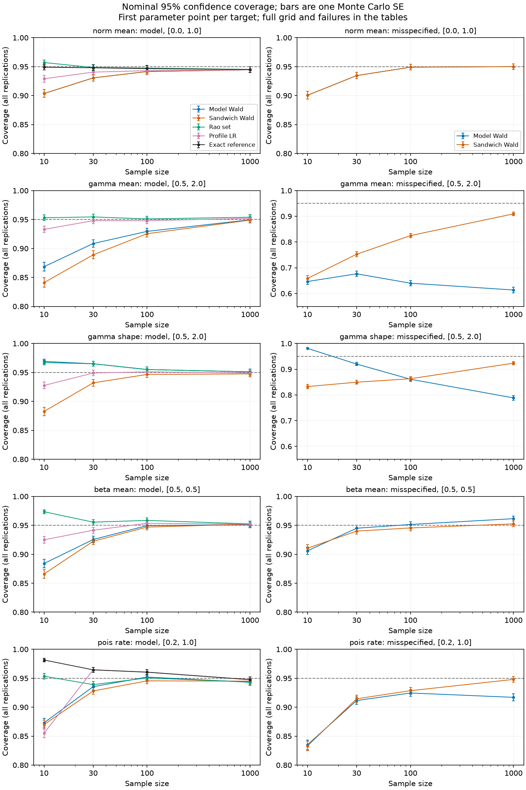

# TASK-102.4: pilot covariance, tests and calibration

Completed 2026-10-31 in `codex/inference-4`, based on
`f39a9c2c77e5a8a572696907d202f3c14a8c0efd` with the uncommitted changes
identified below. No commits, board edits, dependency installs, fitter changes,
golden changes, R/JS exposure, special-function changes or d/p/q/r changes.

The pilot now has conditioning-aware model and sandwich covariance, smooth
contrast variance, nuisance-aware Wald/Rao/profile-LR statistics, Wald and
profile-LR intervals for all five targets, normal t and Poisson Garwood
reference intervals, and explicit normal/Poisson score intervals. Gamma/beta
Rao statistics define confidence sets by pointwise inversion; they are **not
advertised as two-endpoint intervals**. Gamma mean has a demonstrably
unbounded accepted tail. The remaining score endpoint questions are stated
precisely below rather than returning unchecked roots.

The seeded final calibration completed **60 cells, 2,000 replications per
cell, 120,000 samples**: 40 model cells and 20 misspecification cells. The
recommended model defaults are exact t for normal means, Garwood for Poisson
rates, and profile LR for gamma targets from n=30 and beta means from n=100
within this grid. None of the tested ordinary approximate intervals is
sufficiently close to 95% at n=10 for gamma/beta. Sandwich computation does
not establish finite-sample robustness: under the tested lognormal alternative,
even n=1,000 gives only 90.95% gamma-mean sandwich coverage.

Implementation and reproducible evidence:

- [Shared contract and solves](../../../univariateML-cpp/include/cppunivariate/core/inference.hpp),
  [canonical algorithm note](../../../univariateML-cpp/include/cppunivariate/core/inference.md).
- Target wrappers in the four family score headers:
  [normal](../../../univariateML-cpp/include/cppunivariate/distributions/norm/score.hpp),
  [gamma](../../../univariateML-cpp/include/cppunivariate/distributions/gamma/score.hpp),
  [beta](../../../univariateML-cpp/include/cppunivariate/distributions/beta/score.hpp),
  [Poisson](../../../univariateML-cpp/include/cppunivariate/distributions/pois/score.hpp).
- [Calibration launcher](../../validation/inference-4.sh),
  [Python driver](../../validation/inference-4.py),
  [production C++ bridge](../../validation/inference-4-probe.cpp),
  [failure replay and figure source](../../validation/inference-4-summary.py).
- [All counts, seeds, environment and implementation hashes](inference-4/results.json),
  [standalone full tables](inference-4/tables.md),
  [interior failure observations and statuses](inference-4/diagnostics.json),
  [score topology reproducer results](inference-4/score-topology.json).

This extends the [derivative report](2026-10-31-inference-3-report.md) and follows
[the inference plan](../../roadmap/2026-10-30-inference-and-dqm.md). It does not
extend the four-family coverage claim to other families or arbitrary regimes.

## Implemented formulas and contracts

In README natural coordinates and packed free-coordinate order, retain
**every fitted nuisance coefficient**. A held subset means coefficients known
as constants; it does not account for fitting them. The previous contract gives

$$S=\sum_i s_i,\quad J=\sum_i s_i s_i^T,\quad
H=-\sum_i\nabla^2\ell_i,\quad F=n I_1.$$

The new covariance choices are

$$V_F=F^{-1},\qquad V_H=H^{-1},\qquad
V_S=H^{-1}JH^{-T}.$$

There is **no extra division by n**. J is the sum of observation score
cross-products, never the total-score outer product. H is the analytic
negative Hessian, never an optimizer inverse-Hessian approximation. The
sandwich uses observed H as sensitivity estimate; the model Fisher is not
substituted by assumption. For these particular exponential-family pilots,
H and F coincide at an interior MLE in exact arithmetic, including under the
chosen misspecifications. That identity explains equal F/H calibration
columns; it does not make inverse information a robust covariance.

The solver max-entry-scales the symmetric matrix, rejects nonfinite or
asymmetric input, performs Cholesky and checks the existing eigenvalue-based
condition diagnostic, then solves against basis vectors. It supports the
contract's eight-coordinate storage, including all free subsets. No
pseudoinverse, ridge or automatic coordinate rescaling is used. In original
README units, minimum/maximum absolute eigenvalue ratio at most 64 epsilon is
Singular; at most sqrt(epsilon) is IllConditioned. Negative Cholesky pivots
are Indefinite; zero pivots are rejected as Singular. A zero pivot can also
occur on an indefinite matrix, so that latter status is a rejection diagnostic,
not a mathematical classification theorem. Natural-coordinate conditioning
can reject a mathematically full-rank model. No certified floating-point
backward-error bound is claimed.

For a smooth scalar target t(theta), supply its free-coordinate gradient g:

$$\widehat{\operatorname{var}}(\hat t)=g^TVg,\qquad
W=(\hat t-t_0)^2/(g^TVg).$$

The implemented gamma mean uses g=(scale,shape); beta mean uses
g=(b,-a)/(a+b)^2. Shape uses (1,0), normal mean (1,0), and Poisson rate (1).
Wald intervals are t_hat +/- z_(1-alpha/2)*sqrt(g^T V g). They are untransformed
and are not silently clipped to parameter space.

With nuisance fitted under the null, the model-based Rao statistic is

$$R=S(\tilde\theta)^T F(\tilde\theta)^{-1}S(\tilde\theta).$$

Nuisance score is zero at that constrained maximum, so the full inverse gives
the efficient score variance for the one-dimensional constraint. The target's
Hessian block alone would treat nuisance as known and is not used. LR is

$$L=2\{\ell(\hat\theta)-\ell(\tilde\theta)\}.$$

All three approximate tests use chi-square(1) reference cutoff
3.841458820694124 at 5%; Wald's interval cutoff is z_.975. Changing covariance
to Sandwich changes Wald only. The returned Rao and LR remain **model tests**;
they are not misspecification-robust procedures. Low-level helpers accept
successful fit inputs as a caller precondition; family wrappers fit nuisance
and check fitter statuses.

Normal holds the null mean in the existing fitter and profiles sd. Gamma
shape holds shape and profiles scale with the existing fitter. Gamma mean m
requires scale=m/a: the per-observation shape score is

$$\log a-\psi(a)+1+\overline{\log X}-\log m-\bar X/m.$$

Its derivative 1/a-trigamma(a)<0 proves strict concavity. The derivative tends
to positive infinity at zero and has a negative limit for nonconstant data,
by Jensen and log(r)+1-r<=0. Beta mean m holds the ray
(a,b)=k*(m,1-m); the concentration score per observation is

$$m\{\overline{\log X}-\psi(mk)\}
 +(1-m)\{\overline{\log(1-X)}-\psi((1-m)k)\}+\psi(k).$$

Strict concavity of the beta exponential-family likelihood in (a,b) proves
strict concavity along this ray. Both new scalar solves expand positive
brackets until opposite derivative signs certify a unique maximum, then
bisect in log coordinates until bracket width <=1e-12. Failure to find finite
signs or converge fails; no search cap is returned as an estimate. Existing
fitters evaluate the likelihood with both coefficients held. Stable gamma
log-minus-digamma and beta digamma increments reuse existing helpers. No
fitter initialization or default behavior changes.

Profile LR intervals invert L<=critical. Normal has explicit half-width
sd_MLE*sqrt(expm1(critical/n)). Gamma mean profiles have derivative sign
sign(xbar-m); gamma shape profiles are concave. Beta likelihood superlevel
sets are convex in positive (a,b), and their continuous ratio image a/(a+b)
is an interval. These arguments establish connected LR sets in real
arithmetic. Gamma uses log and beta uses logit coordinates: adaptive expansion
must find finite sign brackets on both sides, then bisection reduces each
coordinate bracket width to 1e-10*(1+abs(center)). Exhaustion, invalid or
nonfinite evaluations fail instead of producing an unchecked endpoint.

Normal Rao inversion has half-width sd_MLE*sqrt(critical/(n-critical)) when
n>critical. For Poisson total T, its score roots are

$$(2T+c\ \pm\sqrt{c(4T+c)})/(2n),$$

with a rationalized lower root for accuracy. At T=0, score and LR intervals
are [0,c/n] and [0,c/(2n)]. The interior target-test wrapper reports
unavailable Wald inference at T=0; the calibration evaluates score/LR
membership using those analytic boundary formulas, matching the separately
available interval APIs. Every null in the calibration has positive rate;
this is not a chi-square calibration claim at true rate zero.

Exact normal mean intervals use the t_(n-1) pivot with half-width
qt(1-alpha/2,n-1)*sd_MLE/sqrt(n-1), requiring n>=2 and a nondegenerate sample.
Poisson Garwood intervals use gamma quantiles:

$$[q_\Gamma(\alpha/2,T,1)/n,
   q_\Gamma(1-\alpha/2,T+1,1)/n],$$

with lower endpoint zero for T=0. These are model-based reference procedures.
Their interval inversions give two-sided exact tests; no separate robust
interpretation is attached.

## Statuses and numerical limits

Existing invalid-parameter, invalid-observation, empty-sample, invalid-subset,
numerical-failure, singularity, ill-conditioning and dimension-exceeded
statuses remain. Indefinite is appended without renumbering the old values.
Covariance and contrast results carry status; target results retain separate
Wald, Rao and LR statuses. An unavailable covariance does not erase a valid
LR. On a failed result its numerical payload is unusable.

Singular/ill-conditioned empirical J is allowed as sandwich meat because it
is not inverted; nonfinite or materially indefinite J fails. Zero/nonpositive
or nonfinite delta variance fails. Nonfinite covariance entries or nonpositive
inverse diagonals fail. Zero-dimensional covariance is empty, but a
zero-dimensional contrast has no positive variance and is unavailable.
Unrestricted fitter failure or continuous degeneracy fails the target wrapper;
these wrappers currently group that condition into NumericalFailure rather
than exposing the underlying family enum. Invalid null domains receive
InvalidParameter. This is an integration diagnostic limitation, not a rescued
fit. There is no score-gate override or last-iterate fallback added here.

Finite-difference/independent matrix checks, condition rejections and the
Monte Carlo experiments below are numerical evidence. The concavity,
normalization and confidence-set structure arguments are mathematical
arguments. There is no certified uniform error bound for every positive
parameter, transformed root or special-function expansion. Extreme values
outside this calibration can fail conditioning or arithmetic even where the
real-arithmetic model is regular.

## Calibration design and statistical scope

The four sample sizes are 10,30,100,1000. Model points in README order:
normal (mean,sd)=(0,1),(2,3); gamma (shape,scale)=(.5,2),(5,.4), separately
for mean and shape targets; beta (a,b)=(.5,.5),(2,5); Poisson rate=.2,5.
Every nuisance coefficient is estimated. The target null equals the true
model target, so coverage of the inverted test and type-I error are evaluated
on the same sample. Gamma/beta score columns are **confidence-set** coverage;
LR/Wald/exact columns are interval coverage. Endpoint inversion is unnecessary
in each Monte Carlo replicate: truth belongs iff the corresponding test
accepts. Deterministic endpoint tests check the production interval APIs.

The master seed is 102420261031; independent per-cell NumPy SeedSequence
inputs are [master seed, configuration index, n, alternative indicator]. Each
cell records all four seed components, replication count and source identity.
A completed cell is written by atomic rename. A matching source identity and
replication count allow resuming without recomputing that cell; stale source
identities are recomputed. The final run used 2,000 replications in **every**
cell. Cell files, aggregate results and tables are retained alongside this
report; scratch binaries and logs are regenerable.

Alternatives, one per family, use the first parameter point:

- Normal: scaled t_5, mean 0 and variance 1. Fourth moment is finite, so the
  full normal score cross-products have finite expectation. Model and sandwich
  mean variance coincide with empirical second moment/n; equal coverage is
  expected and is not a general robustness validation.
- Gamma: lognormal with mean m=a*scale and log variance
  v=2*(log(a)-psi(a)), log location log(m)-v/2. Thus E[X]=m and
  E[log X]=psi(a)+log(scale): the **gamma KL projection** has both the stated
  mean and shape. Matching only mean and variance would not establish the
  shape target. All required lognormal X/log-X score moments are finite.
- Beta: equal mixture of Beta(2,8) and Beta(8,2). Symmetry gives pseudo-true
  beta mean .5; the pseudo-true concentration is fitted and is not claimed
  to equal the nominal (.5,.5) concentration. Log sufficient statistics have
  finite moments. The target is the mean of the beta KL projection, equal
  to .5 by symmetry; outside symmetric alternatives a fitted beta mean need
  not equal the population arithmetic mean.
- Poisson: negative binomial with size 1 and mean .2 (geometric on the
  nonnegative integers), variance .24. The Poisson KL projection retains
  mean .2 and all score moments are finite.

Interior model DQM, finite information and model rank follow the previous
exponential-family argument. Hessian suitability, numerical conditioning and
estimator asymptotics are separate questions. Classical chi-square/Wald
limits additionally require consistency and the local likelihood expansion.
Under misspecification sandwich inference needs iid sampling, an interior
identifiable KL maximum, nonsingular expected sensitivity, finite score
second moments and the estimating-equation expansion. The selected
alternatives meet the relevant moment requirements and have the stated
pseudo-targets, but this report does not prove uniform limit approximations
or a finite-sample coverage theorem.

For a cell with N=2000, table coverage is C/N, rejection is R/N and failure
is U/N, with **C+R+U=N**. No failed fit, covariance or boundary replicate is
silently dropped. Failure contributes zero coverage and is not mislabeled
as a rejection. Therefore coverage plus rejection can be less than one;
read failures alongside the reported unconditional type-I error. MCSE is
sqrt(p*(1-p)/N) separately for coverage and rejection. Near 95% coverage or
5% error it is 0.00487, or 0.487 percentage points. Error bars are one MCSE,
not 95% intervals. Zero observed failure is not proof of zero failure risk.
All comparisons here are pointwise exploratory evidence, not multiplicity-
adjusted selection guarantees.



## Failures and boundaries

There were **no interior fitter failures** in the final grid. In the model
gamma (5,.4), n=10 cells, 3/2000 covariance solves per target were
IllConditioned (status 7). The gamma-mean cell also had one null Rao
conditioning failure, overlapping one of those three samples; LR remained
available on all of them. Replay records estimates, exact observations and
procedure statuses in diagnostics.json. Fitted shapes were about 41–55 and
scales .036–.044. The issue is natural-coordinate condition, not mathematical
information rank loss. No coordinate rescue was silently applied.

Poisson boundary totals were 253/2000 at n=10 and 5/2000 at n=30 under rate
.2; under the geometric alternative, 327/2000 and 7/2000 respectively. There
were none at n=100/1000 or model rate 5. These are attained zero-rate MLEs,
not optimizer failures. The stored `fit_failures` count groups those samples
as unavailable for the interior fit contract; the separate `boundaries` and
failure-reason fields identify them. Wald/sandwich fail on those samples;
exact references and analytic score/LR inversions retain them. In particular,
the 87.30% model Wald coverage at n=10, rate .2 has 12.65% unavailability;
it must not be read as a successfully computed Wald interval on every sample.

All other procedure failure counts are zero. As binomial rates, 3/2000 has
MCSE 0.00087, 1/2000 has MCSE 0.00050, 253/2000 MCSE 0.00743, and 327/2000
MCSE 0.00827. Full counts and per-procedure failure accounting are below.

## Recommendations supported by this grid

These are proposed R defaults, not exposed APIs or universal sample-size
rules. Gamma shape/scale and beta shapes matter in addition to n; only the
stated grid has been calibrated.

| Target under its model | n=10 | n=30 | n=100 | n=1000 |
|---|---|---|---|---|
| Normal mean, sd fitted | Exact t | Exact t | Exact t | Exact t |
| Gamma mean, shape fitted | No adequately calibrated ordinary interval among those tested | Profile LR | Profile LR | Profile LR; Wald is a reasonable alternative on this grid |
| Gamma shape, scale fitted | No approximately 95% default; model Wald is conservative (96.75–96.90%) | Profile LR | Profile LR | Profile LR; Wald comparable |
| Beta mean, concentration fitted | No adequately calibrated ordinary interval among those tested | LR remains marginal (94.00–94.15%); no unqualified default | Profile LR | Profile LR; Wald comparable |
| Poisson rate | Garwood | Garwood | Garwood | Garwood |

Normal t has its exact model justification; the two n=10 coverages are
94.90% and 95.75% with MCSE about .49 percentage points. Normal Wald gives
only 90.35–91.70% at n=10. Garwood is conservative for small expected counts
(98.15% at n=10, rate .2), which is preferable to the 85.50% LR coverage in
that cell if model coverage is required. Rao is numerically close to nominal
there, but is still an approximation and does not displace the exact default.

Gamma mean LR gives 94.80–95.00% at n=30 and 94.80–95.85% at n=100;
model Wald remains as low as 92.95% at n=100 for shape .5. Gamma shape LR
at n=10 covers only 92.00–92.75%, while model Wald is conservative and
sandwich gives 88.25–88.90%. Beta LR improves from 92.50–93.40% at n=10 to
94.45–95.35% at n=100. These differences motivate the stated defaults and
small-n gaps, not an assertion that LR is always superior.

Under misspecification, none of these model defaults is generically exact.
For the tested t_5 normal mean, Wald reaches 94.90% at n=100 and 95.00% at
n=1000; both covariance choices coincide. For the symmetric beta mixture,
sandwich Wald is 94.55% at n=100 and 95.25% at n=1000, versus model 95.15%
and 96.15%; offer sandwich as the asymptotic option with its assumptions,
not a finite-sample guarantee. For geometric counts, sandwich Wald reaches
94.80% at n=1000 versus model 91.70%; at n<=100 no tested Wald option
establishes adequate coverage (sandwich 92.85% at n=100).

The lognormal gamma alternative is the clearest caution: mean sandwich
coverage rises from 65.85% at n=10 to 90.95% at n=1000, still short of 95%
by roughly six MCSE. Shape sandwich reaches 92.35% at n=1000, still low;
model shape coverage falls to 78.85%. **None of the tested Wald procedures
is adequate across this gamma alternative at any tested n.** Finite moments
and a computable sandwich do not promise a useful normal approximation at
these sample sizes. No bootstrap validity is claimed or inferred.

## Score confidence sets: resolved obstruction and open entries

For gamma mean under its null, mean and shape are information-orthogonal in
(mean,shape) coordinates and

$$R(m)=n\tilde a(m)(\bar X-m)^2/m^2.$$

As m tends to infinity the constrained score equation implies
 a_tilde(m)~1/log(m), so R(m) tends to zero. Thus a remote upper accepted
tail always exists. For n=100 and 20 repetitions of [.2,.5,1,2,4], the
independent analytic calculation gives R=27.40275 at log(m)=3,
R=9.08450 at log(m)=10, and R=.96975 at log(m)=100; the fitted mean has R=0.
There is an accepted region, a rejected region and a remote accepted region.
The natural-coordinate production API may reject the most extreme nulls
for conditioning; the analytic check does not bypass that rejection.
Returning the first two crossings as a 95% score interval would discard a
part of the confidence set. This is a mathematical obstruction, not a
missing bracket-width adjustment.

**Open: complete Rao-set endpoint representation.** Gamma mean needs a
possibly disconnected confidence-set return type (with unbounded tails),
not a forced two-endpoint interval. For gamma shape and beta mean, a globally
certified monotonicity/topology result for the Rao statistic, or a certified
root-isolation method covering the entire parameter domain, is still missing.
Concavity of the *profile likelihood* proves LR interval structure; it does
not prove score-statistic monotonicity. Pointwise Rao tests and their full-set
coverage are supplied, while bounded score endpoint APIs for these targets
are deliberately unavailable. Extending the interface needs topology and
coordinate-conditioning decisions before numeric endpoints can be advertised.

**Open: small-sample and heavy-tail procedures.** The tables do not support
an approximately nominal ordinary interval among the tested choices for
model gamma/beta at n=10, or gamma Wald under the selected lognormal
alternative even at n=1000. Higher-order calibration or another justified
procedure and an independent calibration study are missing; this job does
not fill that gap with an unvalidated default. The inequalities and numerical
tests here are not uniform finite-sample or floating-point certificates.

## What an R vcov/confint integration needs

No R or JS exposure is included in this job. A thin R layer would need:

1. Retain family id, original observations/sufficient statistics, the free
   mask, held values and parameter order in fitted objects. Distinguish
   default joint fitting from a truly known nuisance. Map C++ names/indices
   to the coefficients and label covariance coordinates and total scaling.
2. Add pilot adapters for scores/covariance/target procedures; propagate
   overall and procedure-specific statuses, conditioning and underlying
   fitter reasons. `vcov(method="model"|"observed"|"sandwich")` should
   identify its assumptions, refuse unavailable blocks and never manufacture
   a pseudoinverse. Known held coefficients need an explicit R representation
   (omit them, or mark them as held); arbitrary zero rows must not be
   mistaken for inferential precision.
3. Supply contrast values/gradients and named full covariance blocks for
   gamma and beta means. `confint` needs method, target, level, held/free
   nuisance handling and domain checks; arbitrary contrasts cannot reuse a
   parameter-only profile without a constrained fitter. Convert chi-square,
   normal and exact t reference statistics to R p-values explicitly.
4. Select exact t and Garwood defaults where their model assumptions apply;
   expose tested profile LR where recommended and gaps at small n. Do not
   present GammaTarget::Mean Rao as an ordinary interval. A confidence-set
   API is needed for disconnected sets; beta/gamma-shape score endpoints
   remain unavailable pending the open certificate above.
5. Route zero Poisson totals to exact or explicitly defined score/LR interval
   calculations; do not ask the interior covariance layer for Wald precision
   at lambda_hat=0. True null lambda=0 needs its own boundary procedure
   contract. Exact methods retain their model assumption; changing vcov to
   sandwich does not make score/LR robust.
6. Add R tests against these C++ values and independent references, every
   held subset, contrasts, confidence levels, failed/ill-conditioned blocks,
   count-zero behavior and interval coverage. The existing R bootstrap
   mechanism supplies no validity theorem for these new methods.

## Final verification and reproduction

Every required final command completed with exit zero. No test failures were
permitted. All work ran locally under the shared slot locks, with the wrappers'
`nice -n 10`, at most four cores and one BLAS/OpenMP thread per process. No
simbox or sub-agents were used. The calibration is one worker (Python plus a
synchronous production C++ bridge) under `run4`, retaining cells for restart;
the cell-to-aggregate output span was about 107 seconds, excluding compilation
and the first cell. It is comfortably below the one-hour four-core budget.

```sh
export TMPDIR=$PWD/build/tmp JUST_TEMPDIR=$PWD/build/tmp XDG_RUNTIME_DIR=$PWD/build/tmp
mkdir -p "$TMPDIR" build/scratch
/tmp/umvl-cpu/run4 bash dev/validation/inference-4.sh --reps 2000
/tmp/umvl-cpu/run4 just cpp-test
/tmp/umvl-cpu/run4 just cpp-test-no-long-double
/tmp/umvl-cpu/run4 just test
/tmp/umvl-cpu/run nice -n 10 python3 dev/validation/inference-4-summary.py
```

The three final test recipes ran sequentially inside one `run4` invocation;
these separate invocations are equivalent reproduction commands. The launcher
compiles the bridge as C++17 with -O2 and a plain Boost include directory from
CMake (or BH as a monorepo convenience); no R linkage is required by it.

| Final run | Result |
|---|---|
| C++ dev | 105/105 shards passed; 34.23 s test execution |
| C++ no-long-double | 126/126 full shards passed; 99.89 s test execution |
| Final calibration | 60/60 cells, 2,000 replications each; independent covariance/statistic/endpoint checks passed |
| Failure replay and score-topology check | Six interior covariance rejections reproduced; disconnected gamma-mean set demonstrated; figure built |
| R dev | FAIL 0, WARN 0, SKIP 151, PASS 19843; 73.515 s elapsed test execution |
| Source identity and count accounting | All calibration hashes match final code; C+R+U=2000 for every procedure/cell |
| `git diff --check` | Passed |

The 151 R skips require the full R tier. R full was not run: no fitters,
d/p/q/r implementation, R exposure or existing test-tier infrastructure was
changed. The no-long-double recipe runs the full C++ tier. Existing unrelated
compiler warnings are not permitted test failures. During development, the
new extreme-null gamma assertion initially expected a successful solve where
natural-coordinate conditioning correctly rejected it; the final regression
uses well-conditioned values for its decreasing-tail check. A postprocessing
JSON boolean serialization error was corrected and that script rerun green.
Neither issue is hidden in the final success counts.

Deterministic checks append to existing family test.cpp files. They cover
closed-form normal covariance/total scaling, sandwich meat, eight-coordinate
storage, symmetry/indefinite/singular/ill-conditioned rejection, gamma mean
gradient variance, both gamma LR intervals, beta mean LR, exact normal and
Poisson boundary intervals, and correct status propagation. The Python
validator independently forms Fisher/score matrices with SciPy and checks
inverse/observed/sandwich against NumPy linear algebra (rtol 1e-8, atol 1e-10);
production constrained Rao and LR against independent null solves and
likelihoods (rtol 2e-7, atol 1e-9/1e-8), LR endpoints against Brent roots
(rtol 2e-7, atol 1e-8, endpoint LR residual <1e-6), and exact t/Garwood
endpoints against SciPy (rtol/atol 1e-12). Production delta variances also
match independently applied gradients throughout the calibration (rtol 2e-7,
atol 1e-11). These checks complement, rather than replace, the previous
independent derivative validation. General endpoint accuracy beyond these
finite cases is not proved by them.

Logs are `build/scratch/inference-4-{cpp-dev,cpp-no-long-double,r-dev,calibration,summary}.log`.
Results and essential provenance are retained here rather than solely in
ignored logs. Build and CPU-slot waiting times are additional to test times.
Environment: Linux x86_64, GCC 15.2.0, C++17, Boost via BH 1.90.0.1,
R 4.6.1, Rcpp 1.1.2; Python/NumPy/SciPy versions follow in retained provenance.

## Complete calibration tables

All nominal intervals/sets are 95%; nominal tests are 5%. Numbers below are
probabilities, and ± is **one MCSE**, not a confidence interval. `wald_F` and
`wald_H` use the model and observed information, `wald_S` uses sandwich.
`score` means full Rao confidence-set membership; `exact` is the model
reference. Under misspecification the rejection column is rejection of the
stated pseudo-target by a Wald procedure, not an exact-model test guarantee.
Failure counts are out of 2,000 and stay in the denominators.

| Family/target | Parameters | n | Alternative | Procedure | Coverage ± MCSE | Type I ± MCSE | Failures |
|---|---|---:|---|---|---|---|---:|
| norm/mean | (0.0, 1.0) | 10 | model | wald_F | 0.9035 ± 0.0066 | 0.0965 ± 0.0066 | 0 |
| norm/mean | (0.0, 1.0) | 10 | model | wald_H | 0.9035 ± 0.0066 | 0.0965 ± 0.0066 | 0 |
| norm/mean | (0.0, 1.0) | 10 | model | wald_S | 0.9035 ± 0.0066 | 0.0965 ± 0.0066 | 0 |
| norm/mean | (0.0, 1.0) | 10 | model | score | 0.9570 ± 0.0045 | 0.0430 ± 0.0045 | 0 |
| norm/mean | (0.0, 1.0) | 10 | model | LR | 0.9290 ± 0.0057 | 0.0710 ± 0.0057 | 0 |
| norm/mean | (0.0, 1.0) | 10 | model | exact | 0.9490 ± 0.0049 | 0.0510 ± 0.0049 | 0 |
| norm/mean | (0.0, 1.0) | 10 | misspecified | wald_F | 0.9005 ± 0.0067 | 0.0995 ± 0.0067 | 0 |
| norm/mean | (0.0, 1.0) | 10 | misspecified | wald_H | 0.9005 ± 0.0067 | 0.0995 ± 0.0067 | 0 |
| norm/mean | (0.0, 1.0) | 10 | misspecified | wald_S | 0.9005 ± 0.0067 | 0.0995 ± 0.0067 | 0 |
| norm/mean | (0.0, 1.0) | 30 | model | wald_F | 0.9305 ± 0.0057 | 0.0695 ± 0.0057 | 0 |
| norm/mean | (0.0, 1.0) | 30 | model | wald_H | 0.9305 ± 0.0057 | 0.0695 ± 0.0057 | 0 |
| norm/mean | (0.0, 1.0) | 30 | model | wald_S | 0.9305 ± 0.0057 | 0.0695 ± 0.0057 | 0 |
| norm/mean | (0.0, 1.0) | 30 | model | score | 0.9485 ± 0.0049 | 0.0515 ± 0.0049 | 0 |
| norm/mean | (0.0, 1.0) | 30 | model | LR | 0.9405 ± 0.0053 | 0.0595 ± 0.0053 | 0 |
| norm/mean | (0.0, 1.0) | 30 | model | exact | 0.9480 ± 0.0050 | 0.0520 ± 0.0050 | 0 |
| norm/mean | (0.0, 1.0) | 30 | misspecified | wald_F | 0.9345 ± 0.0055 | 0.0655 ± 0.0055 | 0 |
| norm/mean | (0.0, 1.0) | 30 | misspecified | wald_H | 0.9345 ± 0.0055 | 0.0655 ± 0.0055 | 0 |
| norm/mean | (0.0, 1.0) | 30 | misspecified | wald_S | 0.9345 ± 0.0055 | 0.0655 ± 0.0055 | 0 |
| norm/mean | (0.0, 1.0) | 100 | model | wald_F | 0.9415 ± 0.0052 | 0.0585 ± 0.0052 | 0 |
| norm/mean | (0.0, 1.0) | 100 | model | wald_H | 0.9415 ± 0.0052 | 0.0585 ± 0.0052 | 0 |
| norm/mean | (0.0, 1.0) | 100 | model | wald_S | 0.9415 ± 0.0052 | 0.0585 ± 0.0052 | 0 |
| norm/mean | (0.0, 1.0) | 100 | model | score | 0.9475 ± 0.0050 | 0.0525 ± 0.0050 | 0 |
| norm/mean | (0.0, 1.0) | 100 | model | LR | 0.9430 ± 0.0052 | 0.0570 ± 0.0052 | 0 |
| norm/mean | (0.0, 1.0) | 100 | model | exact | 0.9465 ± 0.0050 | 0.0535 ± 0.0050 | 0 |
| norm/mean | (0.0, 1.0) | 100 | misspecified | wald_F | 0.9490 ± 0.0049 | 0.0510 ± 0.0049 | 0 |
| norm/mean | (0.0, 1.0) | 100 | misspecified | wald_H | 0.9490 ± 0.0049 | 0.0510 ± 0.0049 | 0 |
| norm/mean | (0.0, 1.0) | 100 | misspecified | wald_S | 0.9490 ± 0.0049 | 0.0510 ± 0.0049 | 0 |
| norm/mean | (0.0, 1.0) | 1000 | model | wald_F | 0.9445 ± 0.0051 | 0.0555 ± 0.0051 | 0 |
| norm/mean | (0.0, 1.0) | 1000 | model | wald_H | 0.9445 ± 0.0051 | 0.0555 ± 0.0051 | 0 |
| norm/mean | (0.0, 1.0) | 1000 | model | wald_S | 0.9445 ± 0.0051 | 0.0555 ± 0.0051 | 0 |
| norm/mean | (0.0, 1.0) | 1000 | model | score | 0.9450 ± 0.0051 | 0.0550 ± 0.0051 | 0 |
| norm/mean | (0.0, 1.0) | 1000 | model | LR | 0.9445 ± 0.0051 | 0.0555 ± 0.0051 | 0 |
| norm/mean | (0.0, 1.0) | 1000 | model | exact | 0.9450 ± 0.0051 | 0.0550 ± 0.0051 | 0 |
| norm/mean | (0.0, 1.0) | 1000 | misspecified | wald_F | 0.9500 ± 0.0049 | 0.0500 ± 0.0049 | 0 |
| norm/mean | (0.0, 1.0) | 1000 | misspecified | wald_H | 0.9500 ± 0.0049 | 0.0500 ± 0.0049 | 0 |
| norm/mean | (0.0, 1.0) | 1000 | misspecified | wald_S | 0.9500 ± 0.0049 | 0.0500 ± 0.0049 | 0 |
| norm/mean | (2.0, 3.0) | 10 | model | wald_F | 0.9170 ± 0.0062 | 0.0830 ± 0.0062 | 0 |
| norm/mean | (2.0, 3.0) | 10 | model | wald_H | 0.9170 ± 0.0062 | 0.0830 ± 0.0062 | 0 |
| norm/mean | (2.0, 3.0) | 10 | model | wald_S | 0.9170 ± 0.0062 | 0.0830 ± 0.0062 | 0 |
| norm/mean | (2.0, 3.0) | 10 | model | score | 0.9640 ± 0.0042 | 0.0360 ± 0.0042 | 0 |
| norm/mean | (2.0, 3.0) | 10 | model | LR | 0.9390 ± 0.0054 | 0.0610 ± 0.0054 | 0 |
| norm/mean | (2.0, 3.0) | 10 | model | exact | 0.9575 ± 0.0045 | 0.0425 ± 0.0045 | 0 |
| norm/mean | (2.0, 3.0) | 30 | model | wald_F | 0.9360 ± 0.0055 | 0.0640 ± 0.0055 | 0 |
| norm/mean | (2.0, 3.0) | 30 | model | wald_H | 0.9360 ± 0.0055 | 0.0640 ± 0.0055 | 0 |
| norm/mean | (2.0, 3.0) | 30 | model | wald_S | 0.9360 ± 0.0055 | 0.0640 ± 0.0055 | 0 |
| norm/mean | (2.0, 3.0) | 30 | model | score | 0.9510 ± 0.0048 | 0.0490 ± 0.0048 | 0 |
| norm/mean | (2.0, 3.0) | 30 | model | LR | 0.9385 ± 0.0054 | 0.0615 ± 0.0054 | 0 |
| norm/mean | (2.0, 3.0) | 30 | model | exact | 0.9495 ± 0.0049 | 0.0505 ± 0.0049 | 0 |
| norm/mean | (2.0, 3.0) | 100 | model | wald_F | 0.9425 ± 0.0052 | 0.0575 ± 0.0052 | 0 |
| norm/mean | (2.0, 3.0) | 100 | model | wald_H | 0.9425 ± 0.0052 | 0.0575 ± 0.0052 | 0 |
| norm/mean | (2.0, 3.0) | 100 | model | wald_S | 0.9425 ± 0.0052 | 0.0575 ± 0.0052 | 0 |
| norm/mean | (2.0, 3.0) | 100 | model | score | 0.9460 ± 0.0051 | 0.0540 ± 0.0051 | 0 |
| norm/mean | (2.0, 3.0) | 100 | model | LR | 0.9445 ± 0.0051 | 0.0555 ± 0.0051 | 0 |
| norm/mean | (2.0, 3.0) | 100 | model | exact | 0.9455 ± 0.0051 | 0.0545 ± 0.0051 | 0 |
| norm/mean | (2.0, 3.0) | 1000 | model | wald_F | 0.9480 ± 0.0050 | 0.0520 ± 0.0050 | 0 |
| norm/mean | (2.0, 3.0) | 1000 | model | wald_H | 0.9480 ± 0.0050 | 0.0520 ± 0.0050 | 0 |
| norm/mean | (2.0, 3.0) | 1000 | model | wald_S | 0.9480 ± 0.0050 | 0.0520 ± 0.0050 | 0 |
| norm/mean | (2.0, 3.0) | 1000 | model | score | 0.9480 ± 0.0050 | 0.0520 ± 0.0050 | 0 |
| norm/mean | (2.0, 3.0) | 1000 | model | LR | 0.9480 ± 0.0050 | 0.0520 ± 0.0050 | 0 |
| norm/mean | (2.0, 3.0) | 1000 | model | exact | 0.9480 ± 0.0050 | 0.0520 ± 0.0050 | 0 |
| gamma/mean | (0.5, 2.0) | 10 | model | wald_F | 0.8685 ± 0.0076 | 0.1315 ± 0.0076 | 0 |
| gamma/mean | (0.5, 2.0) | 10 | model | wald_H | 0.8685 ± 0.0076 | 0.1315 ± 0.0076 | 0 |
| gamma/mean | (0.5, 2.0) | 10 | model | wald_S | 0.8410 ± 0.0082 | 0.1590 ± 0.0082 | 0 |
| gamma/mean | (0.5, 2.0) | 10 | model | score | 0.9530 ± 0.0047 | 0.0470 ± 0.0047 | 0 |
| gamma/mean | (0.5, 2.0) | 10 | model | LR | 0.9330 ± 0.0056 | 0.0670 ± 0.0056 | 0 |
| gamma/mean | (0.5, 2.0) | 10 | misspecified | wald_F | 0.6465 ± 0.0107 | 0.3535 ± 0.0107 | 0 |
| gamma/mean | (0.5, 2.0) | 10 | misspecified | wald_H | 0.6465 ± 0.0107 | 0.3535 ± 0.0107 | 0 |
| gamma/mean | (0.5, 2.0) | 10 | misspecified | wald_S | 0.6585 ± 0.0106 | 0.3415 ± 0.0106 | 0 |
| gamma/mean | (0.5, 2.0) | 30 | model | wald_F | 0.9085 ± 0.0064 | 0.0915 ± 0.0064 | 0 |
| gamma/mean | (0.5, 2.0) | 30 | model | wald_H | 0.9085 ± 0.0064 | 0.0915 ± 0.0064 | 0 |
| gamma/mean | (0.5, 2.0) | 30 | model | wald_S | 0.8890 ± 0.0070 | 0.1110 ± 0.0070 | 0 |
| gamma/mean | (0.5, 2.0) | 30 | model | score | 0.9545 ± 0.0047 | 0.0455 ± 0.0047 | 0 |
| gamma/mean | (0.5, 2.0) | 30 | model | LR | 0.9480 ± 0.0050 | 0.0520 ± 0.0050 | 0 |
| gamma/mean | (0.5, 2.0) | 30 | misspecified | wald_F | 0.6765 ± 0.0105 | 0.3235 ± 0.0105 | 0 |
| gamma/mean | (0.5, 2.0) | 30 | misspecified | wald_H | 0.6765 ± 0.0105 | 0.3235 ± 0.0105 | 0 |
| gamma/mean | (0.5, 2.0) | 30 | misspecified | wald_S | 0.7525 ± 0.0096 | 0.2475 ± 0.0096 | 0 |
| gamma/mean | (0.5, 2.0) | 100 | model | wald_F | 0.9295 ± 0.0057 | 0.0705 ± 0.0057 | 0 |
| gamma/mean | (0.5, 2.0) | 100 | model | wald_H | 0.9295 ± 0.0057 | 0.0705 ± 0.0057 | 0 |
| gamma/mean | (0.5, 2.0) | 100 | model | wald_S | 0.9255 ± 0.0059 | 0.0745 ± 0.0059 | 0 |
| gamma/mean | (0.5, 2.0) | 100 | model | score | 0.9510 ± 0.0048 | 0.0490 ± 0.0048 | 0 |
| gamma/mean | (0.5, 2.0) | 100 | model | LR | 0.9480 ± 0.0050 | 0.0520 ± 0.0050 | 0 |
| gamma/mean | (0.5, 2.0) | 100 | misspecified | wald_F | 0.6400 ± 0.0107 | 0.3600 ± 0.0107 | 0 |
| gamma/mean | (0.5, 2.0) | 100 | misspecified | wald_H | 0.6400 ± 0.0107 | 0.3600 ± 0.0107 | 0 |
| gamma/mean | (0.5, 2.0) | 100 | misspecified | wald_S | 0.8250 ± 0.0085 | 0.1750 ± 0.0085 | 0 |
| gamma/mean | (0.5, 2.0) | 1000 | model | wald_F | 0.9495 ± 0.0049 | 0.0505 ± 0.0049 | 0 |
| gamma/mean | (0.5, 2.0) | 1000 | model | wald_H | 0.9495 ± 0.0049 | 0.0505 ± 0.0049 | 0 |
| gamma/mean | (0.5, 2.0) | 1000 | model | wald_S | 0.9490 ± 0.0049 | 0.0510 ± 0.0049 | 0 |
| gamma/mean | (0.5, 2.0) | 1000 | model | score | 0.9540 ± 0.0047 | 0.0460 ± 0.0047 | 0 |
| gamma/mean | (0.5, 2.0) | 1000 | model | LR | 0.9520 ± 0.0048 | 0.0480 ± 0.0048 | 0 |
| gamma/mean | (0.5, 2.0) | 1000 | misspecified | wald_F | 0.6135 ± 0.0109 | 0.3865 ± 0.0109 | 0 |
| gamma/mean | (0.5, 2.0) | 1000 | misspecified | wald_H | 0.6135 ± 0.0109 | 0.3865 ± 0.0109 | 0 |
| gamma/mean | (0.5, 2.0) | 1000 | misspecified | wald_S | 0.9095 ± 0.0064 | 0.0905 ± 0.0064 | 0 |
| gamma/mean | (5.0, 0.4) | 10 | model | wald_F | 0.8885 ± 0.0070 | 0.1100 ± 0.0070 | 3 |
| gamma/mean | (5.0, 0.4) | 10 | model | wald_H | 0.8885 ± 0.0070 | 0.1100 ± 0.0070 | 3 |
| gamma/mean | (5.0, 0.4) | 10 | model | wald_S | 0.8845 ± 0.0071 | 0.1140 ± 0.0071 | 3 |
| gamma/mean | (5.0, 0.4) | 10 | model | score | 0.9610 ± 0.0043 | 0.0385 ± 0.0043 | 1 |
| gamma/mean | (5.0, 0.4) | 10 | model | LR | 0.9275 ± 0.0058 | 0.0725 ± 0.0058 | 0 |
| gamma/mean | (5.0, 0.4) | 30 | model | wald_F | 0.9325 ± 0.0056 | 0.0675 ± 0.0056 | 0 |
| gamma/mean | (5.0, 0.4) | 30 | model | wald_H | 0.9325 ± 0.0056 | 0.0675 ± 0.0056 | 0 |
| gamma/mean | (5.0, 0.4) | 30 | model | wald_S | 0.9310 ± 0.0057 | 0.0690 ± 0.0057 | 0 |
| gamma/mean | (5.0, 0.4) | 30 | model | score | 0.9595 ± 0.0044 | 0.0405 ± 0.0044 | 0 |
| gamma/mean | (5.0, 0.4) | 30 | model | LR | 0.9500 ± 0.0049 | 0.0500 ± 0.0049 | 0 |
| gamma/mean | (5.0, 0.4) | 100 | model | wald_F | 0.9560 ± 0.0046 | 0.0440 ± 0.0046 | 0 |
| gamma/mean | (5.0, 0.4) | 100 | model | wald_H | 0.9560 ± 0.0046 | 0.0440 ± 0.0046 | 0 |
| gamma/mean | (5.0, 0.4) | 100 | model | wald_S | 0.9535 ± 0.0047 | 0.0465 ± 0.0047 | 0 |
| gamma/mean | (5.0, 0.4) | 100 | model | score | 0.9600 ± 0.0044 | 0.0400 ± 0.0044 | 0 |
| gamma/mean | (5.0, 0.4) | 100 | model | LR | 0.9585 ± 0.0045 | 0.0415 ± 0.0045 | 0 |
| gamma/mean | (5.0, 0.4) | 1000 | model | wald_F | 0.9500 ± 0.0049 | 0.0500 ± 0.0049 | 0 |
| gamma/mean | (5.0, 0.4) | 1000 | model | wald_H | 0.9500 ± 0.0049 | 0.0500 ± 0.0049 | 0 |
| gamma/mean | (5.0, 0.4) | 1000 | model | wald_S | 0.9495 ± 0.0049 | 0.0505 ± 0.0049 | 0 |
| gamma/mean | (5.0, 0.4) | 1000 | model | score | 0.9500 ± 0.0049 | 0.0500 ± 0.0049 | 0 |
| gamma/mean | (5.0, 0.4) | 1000 | model | LR | 0.9500 ± 0.0049 | 0.0500 ± 0.0049 | 0 |
| gamma/shape | (0.5, 2.0) | 10 | model | wald_F | 0.9690 ± 0.0039 | 0.0310 ± 0.0039 | 0 |
| gamma/shape | (0.5, 2.0) | 10 | model | wald_H | 0.9690 ± 0.0039 | 0.0310 ± 0.0039 | 0 |
| gamma/shape | (0.5, 2.0) | 10 | model | wald_S | 0.8825 ± 0.0072 | 0.1175 ± 0.0072 | 0 |
| gamma/shape | (0.5, 2.0) | 10 | model | score | 0.9670 ± 0.0040 | 0.0330 ± 0.0040 | 0 |
| gamma/shape | (0.5, 2.0) | 10 | model | LR | 0.9275 ± 0.0058 | 0.0725 ± 0.0058 | 0 |
| gamma/shape | (0.5, 2.0) | 10 | misspecified | wald_F | 0.9810 ± 0.0031 | 0.0190 ± 0.0031 | 0 |
| gamma/shape | (0.5, 2.0) | 10 | misspecified | wald_H | 0.9810 ± 0.0031 | 0.0190 ± 0.0031 | 0 |
| gamma/shape | (0.5, 2.0) | 10 | misspecified | wald_S | 0.8325 ± 0.0083 | 0.1675 ± 0.0083 | 0 |
| gamma/shape | (0.5, 2.0) | 30 | model | wald_F | 0.9650 ± 0.0041 | 0.0350 ± 0.0041 | 0 |
| gamma/shape | (0.5, 2.0) | 30 | model | wald_H | 0.9650 ± 0.0041 | 0.0350 ± 0.0041 | 0 |
| gamma/shape | (0.5, 2.0) | 30 | model | wald_S | 0.9320 ± 0.0056 | 0.0680 ± 0.0056 | 0 |
| gamma/shape | (0.5, 2.0) | 30 | model | score | 0.9650 ± 0.0041 | 0.0350 ± 0.0041 | 0 |
| gamma/shape | (0.5, 2.0) | 30 | model | LR | 0.9490 ± 0.0049 | 0.0510 ± 0.0049 | 0 |
| gamma/shape | (0.5, 2.0) | 30 | misspecified | wald_F | 0.9200 ± 0.0061 | 0.0800 ± 0.0061 | 0 |
| gamma/shape | (0.5, 2.0) | 30 | misspecified | wald_H | 0.9200 ± 0.0061 | 0.0800 ± 0.0061 | 0 |
| gamma/shape | (0.5, 2.0) | 30 | misspecified | wald_S | 0.8495 ± 0.0080 | 0.1505 ± 0.0080 | 0 |
| gamma/shape | (0.5, 2.0) | 100 | model | wald_F | 0.9550 ± 0.0046 | 0.0450 ± 0.0046 | 0 |
| gamma/shape | (0.5, 2.0) | 100 | model | wald_H | 0.9550 ± 0.0046 | 0.0450 ± 0.0046 | 0 |
| gamma/shape | (0.5, 2.0) | 100 | model | wald_S | 0.9465 ± 0.0050 | 0.0535 ± 0.0050 | 0 |
| gamma/shape | (0.5, 2.0) | 100 | model | score | 0.9550 ± 0.0046 | 0.0450 ± 0.0046 | 0 |
| gamma/shape | (0.5, 2.0) | 100 | model | LR | 0.9510 ± 0.0048 | 0.0490 ± 0.0048 | 0 |
| gamma/shape | (0.5, 2.0) | 100 | misspecified | wald_F | 0.8610 ± 0.0077 | 0.1390 ± 0.0077 | 0 |
| gamma/shape | (0.5, 2.0) | 100 | misspecified | wald_H | 0.8610 ± 0.0077 | 0.1390 ± 0.0077 | 0 |
| gamma/shape | (0.5, 2.0) | 100 | misspecified | wald_S | 0.8630 ± 0.0077 | 0.1370 ± 0.0077 | 0 |
| gamma/shape | (0.5, 2.0) | 1000 | model | wald_F | 0.9510 ± 0.0048 | 0.0490 ± 0.0048 | 0 |
| gamma/shape | (0.5, 2.0) | 1000 | model | wald_H | 0.9510 ± 0.0048 | 0.0490 ± 0.0048 | 0 |
| gamma/shape | (0.5, 2.0) | 1000 | model | wald_S | 0.9475 ± 0.0050 | 0.0525 ± 0.0050 | 0 |
| gamma/shape | (0.5, 2.0) | 1000 | model | score | 0.9510 ± 0.0048 | 0.0490 ± 0.0048 | 0 |
| gamma/shape | (0.5, 2.0) | 1000 | model | LR | 0.9490 ± 0.0049 | 0.0510 ± 0.0049 | 0 |
| gamma/shape | (0.5, 2.0) | 1000 | misspecified | wald_F | 0.7885 ± 0.0091 | 0.2115 ± 0.0091 | 0 |
| gamma/shape | (0.5, 2.0) | 1000 | misspecified | wald_H | 0.7885 ± 0.0091 | 0.2115 ± 0.0091 | 0 |
| gamma/shape | (0.5, 2.0) | 1000 | misspecified | wald_S | 0.9235 ± 0.0059 | 0.0765 ± 0.0059 | 0 |
| gamma/shape | (5.0, 0.4) | 10 | model | wald_F | 0.9675 ± 0.0040 | 0.0310 ± 0.0039 | 3 |
| gamma/shape | (5.0, 0.4) | 10 | model | wald_H | 0.9675 ± 0.0040 | 0.0310 ± 0.0039 | 3 |
| gamma/shape | (5.0, 0.4) | 10 | model | wald_S | 0.8890 ± 0.0070 | 0.1095 ± 0.0070 | 3 |
| gamma/shape | (5.0, 0.4) | 10 | model | score | 0.9670 ± 0.0040 | 0.0330 ± 0.0040 | 0 |
| gamma/shape | (5.0, 0.4) | 10 | model | LR | 0.9200 ± 0.0061 | 0.0800 ± 0.0061 | 0 |
| gamma/shape | (5.0, 0.4) | 30 | model | wald_F | 0.9570 ± 0.0045 | 0.0430 ± 0.0045 | 0 |
| gamma/shape | (5.0, 0.4) | 30 | model | wald_H | 0.9570 ± 0.0045 | 0.0430 ± 0.0045 | 0 |
| gamma/shape | (5.0, 0.4) | 30 | model | wald_S | 0.9240 ± 0.0059 | 0.0760 ± 0.0059 | 0 |
| gamma/shape | (5.0, 0.4) | 30 | model | score | 0.9570 ± 0.0045 | 0.0430 ± 0.0045 | 0 |
| gamma/shape | (5.0, 0.4) | 30 | model | LR | 0.9425 ± 0.0052 | 0.0575 ± 0.0052 | 0 |
| gamma/shape | (5.0, 0.4) | 100 | model | wald_F | 0.9625 ± 0.0042 | 0.0375 ± 0.0042 | 0 |
| gamma/shape | (5.0, 0.4) | 100 | model | wald_H | 0.9625 ± 0.0042 | 0.0375 ± 0.0042 | 0 |
| gamma/shape | (5.0, 0.4) | 100 | model | wald_S | 0.9470 ± 0.0050 | 0.0530 ± 0.0050 | 0 |
| gamma/shape | (5.0, 0.4) | 100 | model | score | 0.9625 ± 0.0042 | 0.0375 ± 0.0042 | 0 |
| gamma/shape | (5.0, 0.4) | 100 | model | LR | 0.9535 ± 0.0047 | 0.0465 ± 0.0047 | 0 |
| gamma/shape | (5.0, 0.4) | 1000 | model | wald_F | 0.9450 ± 0.0051 | 0.0550 ± 0.0051 | 0 |
| gamma/shape | (5.0, 0.4) | 1000 | model | wald_H | 0.9450 ± 0.0051 | 0.0550 ± 0.0051 | 0 |
| gamma/shape | (5.0, 0.4) | 1000 | model | wald_S | 0.9455 ± 0.0051 | 0.0545 ± 0.0051 | 0 |
| gamma/shape | (5.0, 0.4) | 1000 | model | score | 0.9450 ± 0.0051 | 0.0550 ± 0.0051 | 0 |
| gamma/shape | (5.0, 0.4) | 1000 | model | LR | 0.9465 ± 0.0050 | 0.0535 ± 0.0050 | 0 |
| beta/mean | (0.5, 0.5) | 10 | model | wald_F | 0.8840 ± 0.0072 | 0.1160 ± 0.0072 | 0 |
| beta/mean | (0.5, 0.5) | 10 | model | wald_H | 0.8840 ± 0.0072 | 0.1160 ± 0.0072 | 0 |
| beta/mean | (0.5, 0.5) | 10 | model | wald_S | 0.8660 ± 0.0076 | 0.1340 ± 0.0076 | 0 |
| beta/mean | (0.5, 0.5) | 10 | model | score | 0.9735 ± 0.0036 | 0.0265 ± 0.0036 | 0 |
| beta/mean | (0.5, 0.5) | 10 | model | LR | 0.9250 ± 0.0059 | 0.0750 ± 0.0059 | 0 |
| beta/mean | (0.5, 0.5) | 10 | misspecified | wald_F | 0.9060 ± 0.0065 | 0.0940 ± 0.0065 | 0 |
| beta/mean | (0.5, 0.5) | 10 | misspecified | wald_H | 0.9060 ± 0.0065 | 0.0940 ± 0.0065 | 0 |
| beta/mean | (0.5, 0.5) | 10 | misspecified | wald_S | 0.9105 ± 0.0064 | 0.0895 ± 0.0064 | 0 |
| beta/mean | (0.5, 0.5) | 30 | model | wald_F | 0.9255 ± 0.0059 | 0.0745 ± 0.0059 | 0 |
| beta/mean | (0.5, 0.5) | 30 | model | wald_H | 0.9255 ± 0.0059 | 0.0745 ± 0.0059 | 0 |
| beta/mean | (0.5, 0.5) | 30 | model | wald_S | 0.9225 ± 0.0060 | 0.0775 ± 0.0060 | 0 |
| beta/mean | (0.5, 0.5) | 30 | model | score | 0.9555 ± 0.0046 | 0.0445 ± 0.0046 | 0 |
| beta/mean | (0.5, 0.5) | 30 | model | LR | 0.9415 ± 0.0052 | 0.0585 ± 0.0052 | 0 |
| beta/mean | (0.5, 0.5) | 30 | misspecified | wald_F | 0.9450 ± 0.0051 | 0.0550 ± 0.0051 | 0 |
| beta/mean | (0.5, 0.5) | 30 | misspecified | wald_H | 0.9450 ± 0.0051 | 0.0550 ± 0.0051 | 0 |
| beta/mean | (0.5, 0.5) | 30 | misspecified | wald_S | 0.9400 ± 0.0053 | 0.0600 ± 0.0053 | 0 |
| beta/mean | (0.5, 0.5) | 100 | model | wald_F | 0.9495 ± 0.0049 | 0.0505 ± 0.0049 | 0 |
| beta/mean | (0.5, 0.5) | 100 | model | wald_H | 0.9495 ± 0.0049 | 0.0505 ± 0.0049 | 0 |
| beta/mean | (0.5, 0.5) | 100 | model | wald_S | 0.9470 ± 0.0050 | 0.0530 ± 0.0050 | 0 |
| beta/mean | (0.5, 0.5) | 100 | model | score | 0.9585 ± 0.0045 | 0.0415 ± 0.0045 | 0 |
| beta/mean | (0.5, 0.5) | 100 | model | LR | 0.9535 ± 0.0047 | 0.0465 ± 0.0047 | 0 |
| beta/mean | (0.5, 0.5) | 100 | misspecified | wald_F | 0.9515 ± 0.0048 | 0.0485 ± 0.0048 | 0 |
| beta/mean | (0.5, 0.5) | 100 | misspecified | wald_H | 0.9515 ± 0.0048 | 0.0485 ± 0.0048 | 0 |
| beta/mean | (0.5, 0.5) | 100 | misspecified | wald_S | 0.9455 ± 0.0051 | 0.0545 ± 0.0051 | 0 |
| beta/mean | (0.5, 0.5) | 1000 | model | wald_F | 0.9510 ± 0.0048 | 0.0490 ± 0.0048 | 0 |
| beta/mean | (0.5, 0.5) | 1000 | model | wald_H | 0.9510 ± 0.0048 | 0.0490 ± 0.0048 | 0 |
| beta/mean | (0.5, 0.5) | 1000 | model | wald_S | 0.9520 ± 0.0048 | 0.0480 ± 0.0048 | 0 |
| beta/mean | (0.5, 0.5) | 1000 | model | score | 0.9525 ± 0.0048 | 0.0475 ± 0.0048 | 0 |
| beta/mean | (0.5, 0.5) | 1000 | model | LR | 0.9520 ± 0.0048 | 0.0480 ± 0.0048 | 0 |
| beta/mean | (0.5, 0.5) | 1000 | misspecified | wald_F | 0.9615 ± 0.0043 | 0.0385 ± 0.0043 | 0 |
| beta/mean | (0.5, 0.5) | 1000 | misspecified | wald_H | 0.9615 ± 0.0043 | 0.0385 ± 0.0043 | 0 |
| beta/mean | (0.5, 0.5) | 1000 | misspecified | wald_S | 0.9525 ± 0.0048 | 0.0475 ± 0.0048 | 0 |
| beta/mean | (2.0, 5.0) | 10 | model | wald_F | 0.9005 ± 0.0067 | 0.0995 ± 0.0067 | 0 |
| beta/mean | (2.0, 5.0) | 10 | model | wald_H | 0.9005 ± 0.0067 | 0.0995 ± 0.0067 | 0 |
| beta/mean | (2.0, 5.0) | 10 | model | wald_S | 0.8975 ± 0.0068 | 0.1025 ± 0.0068 | 0 |
| beta/mean | (2.0, 5.0) | 10 | model | score | 0.9605 ± 0.0044 | 0.0395 ± 0.0044 | 0 |
| beta/mean | (2.0, 5.0) | 10 | model | LR | 0.9340 ± 0.0056 | 0.0660 ± 0.0056 | 0 |
| beta/mean | (2.0, 5.0) | 30 | model | wald_F | 0.9310 ± 0.0057 | 0.0690 ± 0.0057 | 0 |
| beta/mean | (2.0, 5.0) | 30 | model | wald_H | 0.9310 ± 0.0057 | 0.0690 ± 0.0057 | 0 |
| beta/mean | (2.0, 5.0) | 30 | model | wald_S | 0.9275 ± 0.0058 | 0.0725 ± 0.0058 | 0 |
| beta/mean | (2.0, 5.0) | 30 | model | score | 0.9480 ± 0.0050 | 0.0520 ± 0.0050 | 0 |
| beta/mean | (2.0, 5.0) | 30 | model | LR | 0.9400 ± 0.0053 | 0.0600 ± 0.0053 | 0 |
| beta/mean | (2.0, 5.0) | 100 | model | wald_F | 0.9420 ± 0.0052 | 0.0580 ± 0.0052 | 0 |
| beta/mean | (2.0, 5.0) | 100 | model | wald_H | 0.9420 ± 0.0052 | 0.0580 ± 0.0052 | 0 |
| beta/mean | (2.0, 5.0) | 100 | model | wald_S | 0.9435 ± 0.0052 | 0.0565 ± 0.0052 | 0 |
| beta/mean | (2.0, 5.0) | 100 | model | score | 0.9470 ± 0.0050 | 0.0530 ± 0.0050 | 0 |
| beta/mean | (2.0, 5.0) | 100 | model | LR | 0.9445 ± 0.0051 | 0.0555 ± 0.0051 | 0 |
| beta/mean | (2.0, 5.0) | 1000 | model | wald_F | 0.9490 ± 0.0049 | 0.0510 ± 0.0049 | 0 |
| beta/mean | (2.0, 5.0) | 1000 | model | wald_H | 0.9490 ± 0.0049 | 0.0510 ± 0.0049 | 0 |
| beta/mean | (2.0, 5.0) | 1000 | model | wald_S | 0.9485 ± 0.0049 | 0.0515 ± 0.0049 | 0 |
| beta/mean | (2.0, 5.0) | 1000 | model | score | 0.9470 ± 0.0050 | 0.0530 ± 0.0050 | 0 |
| beta/mean | (2.0, 5.0) | 1000 | model | LR | 0.9470 ± 0.0050 | 0.0530 ± 0.0050 | 0 |
| pois/rate | (0.2, 1.0) | 10 | model | wald_F | 0.8730 ± 0.0074 | 0.0005 ± 0.0005 | 253 |
| pois/rate | (0.2, 1.0) | 10 | model | wald_H | 0.8730 ± 0.0074 | 0.0005 ± 0.0005 | 253 |
| pois/rate | (0.2, 1.0) | 10 | model | wald_S | 0.8700 ± 0.0075 | 0.0035 ± 0.0013 | 253 |
| pois/rate | (0.2, 1.0) | 10 | model | score | 0.9535 ± 0.0047 | 0.0465 ± 0.0047 | 0 |
| pois/rate | (0.2, 1.0) | 10 | model | LR | 0.8550 ± 0.0079 | 0.1450 ± 0.0079 | 0 |
| pois/rate | (0.2, 1.0) | 10 | model | exact | 0.9815 ± 0.0030 | 0.0185 ± 0.0030 | 0 |
| pois/rate | (0.2, 1.0) | 10 | misspecified | wald_F | 0.8350 ± 0.0083 | 0.0015 ± 0.0009 | 327 |
| pois/rate | (0.2, 1.0) | 10 | misspecified | wald_H | 0.8350 ± 0.0083 | 0.0015 ± 0.0009 | 327 |
| pois/rate | (0.2, 1.0) | 10 | misspecified | wald_S | 0.8330 ± 0.0083 | 0.0035 ± 0.0013 | 327 |
| pois/rate | (0.2, 1.0) | 30 | model | wald_F | 0.9355 ± 0.0055 | 0.0620 ± 0.0054 | 5 |
| pois/rate | (0.2, 1.0) | 30 | model | wald_H | 0.9355 ± 0.0055 | 0.0620 ± 0.0054 | 5 |
| pois/rate | (0.2, 1.0) | 30 | model | wald_S | 0.9280 ± 0.0058 | 0.0695 ± 0.0057 | 5 |
| pois/rate | (0.2, 1.0) | 30 | model | score | 0.9390 ± 0.0054 | 0.0610 ± 0.0054 | 0 |
| pois/rate | (0.2, 1.0) | 30 | model | LR | 0.9645 ± 0.0041 | 0.0355 ± 0.0041 | 0 |
| pois/rate | (0.2, 1.0) | 30 | model | exact | 0.9645 ± 0.0041 | 0.0355 ± 0.0041 | 0 |
| pois/rate | (0.2, 1.0) | 30 | misspecified | wald_F | 0.9115 ± 0.0064 | 0.0850 ± 0.0062 | 7 |
| pois/rate | (0.2, 1.0) | 30 | misspecified | wald_H | 0.9115 ± 0.0064 | 0.0850 ± 0.0062 | 7 |
| pois/rate | (0.2, 1.0) | 30 | misspecified | wald_S | 0.9145 ± 0.0063 | 0.0820 ± 0.0061 | 7 |
| pois/rate | (0.2, 1.0) | 100 | model | wald_F | 0.9520 ± 0.0048 | 0.0480 ± 0.0048 | 0 |
| pois/rate | (0.2, 1.0) | 100 | model | wald_H | 0.9520 ± 0.0048 | 0.0480 ± 0.0048 | 0 |
| pois/rate | (0.2, 1.0) | 100 | model | wald_S | 0.9455 ± 0.0051 | 0.0545 ± 0.0051 | 0 |
| pois/rate | (0.2, 1.0) | 100 | model | score | 0.9505 ± 0.0049 | 0.0495 ± 0.0049 | 0 |
| pois/rate | (0.2, 1.0) | 100 | model | LR | 0.9605 ± 0.0044 | 0.0395 ± 0.0044 | 0 |
| pois/rate | (0.2, 1.0) | 100 | model | exact | 0.9605 ± 0.0044 | 0.0395 ± 0.0044 | 0 |
| pois/rate | (0.2, 1.0) | 100 | misspecified | wald_F | 0.9245 ± 0.0059 | 0.0755 ± 0.0059 | 0 |
| pois/rate | (0.2, 1.0) | 100 | misspecified | wald_H | 0.9245 ± 0.0059 | 0.0755 ± 0.0059 | 0 |
| pois/rate | (0.2, 1.0) | 100 | misspecified | wald_S | 0.9285 ± 0.0058 | 0.0715 ± 0.0058 | 0 |
| pois/rate | (0.2, 1.0) | 1000 | model | wald_F | 0.9430 ± 0.0052 | 0.0570 ± 0.0052 | 0 |
| pois/rate | (0.2, 1.0) | 1000 | model | wald_H | 0.9430 ± 0.0052 | 0.0570 ± 0.0052 | 0 |
| pois/rate | (0.2, 1.0) | 1000 | model | wald_S | 0.9450 ± 0.0051 | 0.0550 ± 0.0051 | 0 |
| pois/rate | (0.2, 1.0) | 1000 | model | score | 0.9435 ± 0.0052 | 0.0565 ± 0.0052 | 0 |
| pois/rate | (0.2, 1.0) | 1000 | model | LR | 0.9475 ± 0.0050 | 0.0525 ± 0.0050 | 0 |
| pois/rate | (0.2, 1.0) | 1000 | model | exact | 0.9475 ± 0.0050 | 0.0525 ± 0.0050 | 0 |
| pois/rate | (0.2, 1.0) | 1000 | misspecified | wald_F | 0.9170 ± 0.0062 | 0.0830 ± 0.0062 | 0 |
| pois/rate | (0.2, 1.0) | 1000 | misspecified | wald_H | 0.9170 ± 0.0062 | 0.0830 ± 0.0062 | 0 |
| pois/rate | (0.2, 1.0) | 1000 | misspecified | wald_S | 0.9480 ± 0.0050 | 0.0520 ± 0.0050 | 0 |
| pois/rate | (5.0, 1.0) | 10 | model | wald_F | 0.9505 ± 0.0049 | 0.0495 ± 0.0049 | 0 |
| pois/rate | (5.0, 1.0) | 10 | model | wald_H | 0.9505 ± 0.0049 | 0.0495 ± 0.0049 | 0 |
| pois/rate | (5.0, 1.0) | 10 | model | wald_S | 0.9120 ± 0.0063 | 0.0880 ± 0.0063 | 0 |
| pois/rate | (5.0, 1.0) | 10 | model | score | 0.9435 ± 0.0052 | 0.0565 ± 0.0052 | 0 |
| pois/rate | (5.0, 1.0) | 10 | model | LR | 0.9550 ± 0.0046 | 0.0450 ± 0.0046 | 0 |
| pois/rate | (5.0, 1.0) | 10 | model | exact | 0.9550 ± 0.0046 | 0.0450 ± 0.0046 | 0 |
| pois/rate | (5.0, 1.0) | 30 | model | wald_F | 0.9550 ± 0.0046 | 0.0450 ± 0.0046 | 0 |
| pois/rate | (5.0, 1.0) | 30 | model | wald_H | 0.9550 ± 0.0046 | 0.0450 ± 0.0046 | 0 |
| pois/rate | (5.0, 1.0) | 30 | model | wald_S | 0.9315 ± 0.0056 | 0.0685 ± 0.0056 | 0 |
| pois/rate | (5.0, 1.0) | 30 | model | score | 0.9585 ± 0.0045 | 0.0415 ± 0.0045 | 0 |
| pois/rate | (5.0, 1.0) | 30 | model | LR | 0.9510 ± 0.0048 | 0.0490 ± 0.0048 | 0 |
| pois/rate | (5.0, 1.0) | 30 | model | exact | 0.9585 ± 0.0045 | 0.0415 ± 0.0045 | 0 |
| pois/rate | (5.0, 1.0) | 100 | model | wald_F | 0.9445 ± 0.0051 | 0.0555 ± 0.0051 | 0 |
| pois/rate | (5.0, 1.0) | 100 | model | wald_H | 0.9445 ± 0.0051 | 0.0555 ± 0.0051 | 0 |
| pois/rate | (5.0, 1.0) | 100 | model | wald_S | 0.9435 ± 0.0052 | 0.0565 ± 0.0052 | 0 |
| pois/rate | (5.0, 1.0) | 100 | model | score | 0.9460 ± 0.0051 | 0.0540 ± 0.0051 | 0 |
| pois/rate | (5.0, 1.0) | 100 | model | LR | 0.9480 ± 0.0050 | 0.0520 ± 0.0050 | 0 |
| pois/rate | (5.0, 1.0) | 100 | model | exact | 0.9480 ± 0.0050 | 0.0520 ± 0.0050 | 0 |
| pois/rate | (5.0, 1.0) | 1000 | model | wald_F | 0.9545 ± 0.0047 | 0.0455 ± 0.0047 | 0 |
| pois/rate | (5.0, 1.0) | 1000 | model | wald_H | 0.9545 ± 0.0047 | 0.0455 ± 0.0047 | 0 |
| pois/rate | (5.0, 1.0) | 1000 | model | wald_S | 0.9545 ± 0.0047 | 0.0455 ± 0.0047 | 0 |
| pois/rate | (5.0, 1.0) | 1000 | model | score | 0.9535 ± 0.0047 | 0.0465 ± 0.0047 | 0 |
| pois/rate | (5.0, 1.0) | 1000 | model | LR | 0.9535 ± 0.0047 | 0.0465 ± 0.0047 | 0 |
| pois/rate | (5.0, 1.0) | 1000 | model | exact | 0.9545 ± 0.0047 | 0.0455 ± 0.0047 | 0 |

## Tested implementation identities

Revision and hashes identify the final uncommitted implementation. The
[additional source inventory](inference-4/source-identities.json) also records
the appended family tests, launcher, postprocessing script and algorithm note.

```json
{
  "source_revision": "f39a9c2c77e5a8a572696907d202f3c14a8c0efd",
  "environment": {
    "python": "3.14.5",
    "numpy": "2.4.6",
    "scipy": "1.18.0"
  },
  "hashes": {
    "dev/validation/inference-4.py": "fe6b8c2c1be0731d2a5826107c7e8b6900108aafb9aa21c4ababcabab657bae6",
    "dev/validation/inference-4-probe.cpp": "9b7e3d6e6b481cd4dba8d4b0e6483b5364eaf664cc265e1adfc65aee70883db5",
    "univariateML-cpp/include/cppunivariate/core/inference.hpp": "d185075fb3bea9b7755831110944ca296819736319127f821c50eab16e0e9c9a",
    "univariateML-cpp/include/cppunivariate/distributions/norm/score.hpp": "ceb534e327c696698ab6d4958b0d7725c7d39b34bbfd8d85167b4932df76e6e4",
    "univariateML-cpp/include/cppunivariate/distributions/norm/mle.hpp": "2ca588e634d2a25805d9f8463d7fe4eec0583a2e38f738a08e6373401f0c45a5",
    "univariateML-cpp/include/cppunivariate/distributions/gamma/score.hpp": "f0954e30f376b4552c1a27e0d222d73018f9a68c4c9dc6d05703449c7c259a9f",
    "univariateML-cpp/include/cppunivariate/distributions/gamma/mle.hpp": "f7041946a6096d333e2a4f133aa7de44447597c7569a78f007906e67136a7447",
    "univariateML-cpp/include/cppunivariate/distributions/beta/score.hpp": "e842ff5ad7a2de30d3641890d8fb8fa7b726c174466ad2475e09aea1bf051926",
    "univariateML-cpp/include/cppunivariate/distributions/beta/mle.hpp": "ee4a33c865fcb77fb65bc78750412b5127a704fee9ab59649cd87545f2482896",
    "univariateML-cpp/include/cppunivariate/distributions/pois/score.hpp": "8deb3e404c816760c2e71404ac740b02a70dd6e296d7df04bd3de33e01c65f6f",
    "univariateML-cpp/include/cppunivariate/distributions/pois/mle.hpp": "300eb459f97fb04ab74bb09e2fd0a36f9d214ccb3e06a38f9a0124d314a332c6"
  }
}
```
