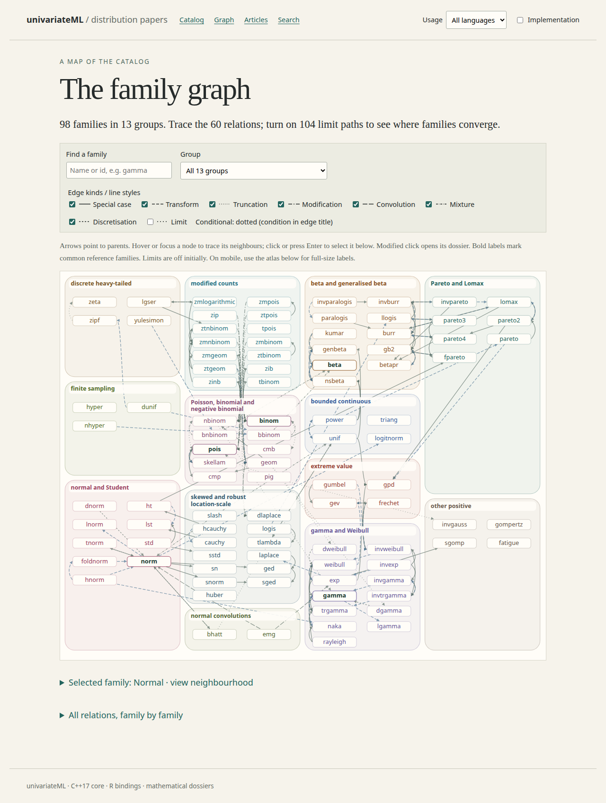

# Construction relations, 2026-10-31

This work adds conditional identities, independent convolutions, continuous
mixtures and floor discretisations to the catalog. It also supports exp,
expit and positive affine transformations. No fitter, default, golden or
d/p/q/r implementation changes are intended. Source base and final validation
results are recorded below; the working changes are deliberately uncommitted.

## Schema and verification

The canonical schema is
[README_SCHEMA.md](../../../univariateML-cpp/include/cppunivariate/distributions/README_SCHEMA.md#construction-edges-and-conditions-2026-10-31).
All maps use child coefficient names and cover every coefficient of their
referenced family. Numeric constants are numbers, and maps are hand-simplified.

| Kind | Declaration and numerical check | Tolerance |
|---|---|---|
| Conditional existing edge | Optional `when` limits the identity to a child-coefficient region. Draws outside it do not count toward the required 24 accepted draws. Existing density, support, Jacobian and conditioning checks still apply. | Relative log-density `2e-9` |
| `convolution_of` | Two independent `{family, at}` components, `operation: sum` or `difference`, optional additive `shift`; top-level `family` repeats the first component. Direct convolution integral for real laws, infinite summation for integer laws, after intersecting component supports. | Relative log-density `2e-8` |
| `mixture_of` | Complete conditional-parent `at`, a `mixed` coefficient name, and complete `mixing: {family, at}`. Reserved `mix` occurs only in the randomized parent coefficient. Integrate conditional density against mixing density; optional `shift` translates the result. | Relative log-density `2e-8` |
| `discretisation_of` | Complete continuous-parent map; child is floor(parent). Integrate parent density on `[k,k+1]` and check the floor image of support. | Relative log-density `2e-8` |
| New transforms | `exp` and `expit` give the parent variable; `affine` gives `(X-shift)/scale` with positive scale. Check inverse-image support and absolute Jacobian. | Relative log-density `2e-9` |

The seed is 20261031; every identity needs 24 accepted parameter draws in at
most 480 attempts. The first attempt uses the simulation seed, subsequent
attempts jitter it and enforce dependent child domains. Construction integration
and sums use mpmath at 35 decimal digits. A density discrepancy or nonfinite
result fails. The conditional mixture maps are checked at quadrature nodes.
These are numerical regression checks, not a mathematical proof over the full
parameter space, validated interval quadrature or a certified tail-error bound.
Existing symbolic simplifications retain their separate symbolic status.

The immediate-edge check excludes conditional steps when claiming an
unconditional derivation, rejects opposite log/exp and logit/expit arrows, and
extends the one-construction-plus-special-case path check to the new kinds.
For mixtures it also compares a composed child shift/special-case, mixing
map, conditional-parent map and optional parent special-case embedding.
It deliberately does not infer implications between different conditions or
compose two arbitrary constructions. Component and mixing targets are all
shown in the graph, with repeated same-family components collapsed visually;
the complete construction remains in every arrow title. The site coverage
check was extended to these multiple targets. Conditional arrows are dotted;
the legend explains the condition title.

## Declarations

| Kind | Added declarations |
|---|---|
| Conditional special cases | binom → cmb (`size <= 10000000`); geom → dgamma and dweibull (`prob < 1`) |
| Conditional truncations | zipf → zeta (`s > 1`); geom and ztgeom → dlaplace (`prob < 1`, centers 0 and 1) |
| Independent convolutions | emg = norm + exp; bhatt = norm + unif(-a,a), `a > 0`; skellam = pois(mu1) - pois(mu2), positive rates; dlaplace = location + geom(1-scale) - geom(1-scale) |
| Mixtures | bbinom = beta-mixed binom; bnbinom = beta-mixed nbinom; nbinom = gamma-mixed pois (`size > 0 && prob < 1`); pig = invgauss-mixed pois (`shape > 0`); slash = norm(mu,sigma/mix), mix uniform(0,1) |
| Floor discretisations | dnorm → norm; dgamma → gamma(shape,1/rate); dweibull → weibull(shape2,(-log(shape1))**(-1/shape2)) |
| Affine | nsbeta → beta with shift=min, scale=max-min |
| Reoriented transformations | None after review: the proposed exp/expit reorientations were reverted (see the review note at the end). |

Net additions are 19: six conditional existing-kind edges, four convolutions,
five mixtures, three discretisations and one affine edge.

## Rejected or restricted candidates

- The direct Yule--Simon beta-geometric mixture is numerically correct but
  **derivable**: Yule--Simon minus one is beta-negative-binomial at size=1,
  alpha=rho, beta=1; the new beta-negative-binomial edge mixes negative
  binomial over probability by that beta law; negative binomial size=1 is
  geometric. The mapped-mixture check compares both coefficient maps and
  total shift symbolically and rejects this direct edge. Its truth remains
  an explicit numerical regression probe.

- Unconditional Zipf → Zeta is invalid for `s <= 1`; unconditional binomial
  → CMB exceeds its declared allocation cap. Conditional declarations retain
  exactly the valid regions, without changing either family's domain.
- The geometric intersections with discrete gamma, discrete Weibull and
  discrete Laplace require `prob < 1`. Their mapped parents exclude the
  attained geometric point mass at probability one.
- Bhattacharjee at `a=0` would require a zero-width uniform component absent
  from the catalog domain. The convolution is explicitly restricted to a>0;
  its existing normal special-case relation records the attained face.
- Negative binomial at zero size or probability one would require a degenerate
  gamma mixing law. PIG at zero shape requires a degenerate inverse Gaussian.
  Neither is a valid finite map into the declared mixing family.
- Skellam's zero-rate faces retain the existing signed-Poisson relations.
  Its generic Bessel density has removable singularities there, so the new
  numerical convolution declaration uses strictly positive rates.
- Reverse exp/log and expit/logit declarations are alternative descriptions
  of one identity, not additional independent graph relations.
- General nonlinear transformations, joint conditioning, extrema, and finite
  two-kernel mixtures (triangular and fatigue constructions proposed in the
  [previous report](2026-10-31-relations-2-report.md)) are outside these precise
  new kinds. They were not represented by an invalid one-coefficient mixture.

## Families still isolated

Five families remain isolated when counting all component and mixing-family
endpoints (limits do not count):

- **fatigue**: its normal transformation needs a nonlinear square-root map;
  its two-kernel inverse-Gaussian construction is not one-coefficient mixing.
- **gompertz**: its exact exponential construction needs an exp-and-shift
  composition; the reflected Gumbel construction also needs conditioning.
- **huber**: normal and Laplace arise as limits, not finite positive-epsilon
  members of either family.
- **hyper**: conditioning two independent binomials on their total requires
  a joint event rather than one-parent support conditioning.
- **triang**: a finite mixture of two affine beta kernels needs explicit
  component weights and treatment of endpoint-mode zero-weight components.

## Validation

The final foreground sequence passed relation unit tests, `just relations`,
`just test`, `just site-check`, the graph browser check and the scope audit
inside one `/tmp/umvl-cpu/run4` allocation. R full passed in a separate
four-slot allocation. All commands used worktree-local `build/tmp` for
TMPDIR, JUST_TEMPDIR and XDG_RUNTIME_DIR; the wrappers applied nice 10 and
one-thread BLAS/OpenMP settings. The requested site dependencies were copied
with `cp -a`; no dependencies were installed. The temporary installation of
the generated R package is part of the required test recipe.

| Check | Final result |
|---|---|
| `PYTHONPATH=dev/validation python3 -m unittest quality.test_relations` | 41 tests, OK. Includes loader rejection cases, bad construction maps, conditions excluding seeds, unreachable conditions, new transforms, construction derivations and the true-but-redundant Yule–Simon probe. |
| `just relations` | 155 declarations, zero failed; immediate-edge policy passes. |
| `just test` (R dev) | FAIL 0, WARN 0, SKIP 151, PASS 18887. |
| `just test-full` | FAIL 0, WARN 0, SKIP 1, PASS 39040. Same fitter and binding sources; this run preceded removal of the redundant Yule–Simon metadata arrow. The subsequent final R dev run regenerated and tested the 155-edge metadata. |
| `just site-check` | Passed: 98 nodes, 266 rendered arrows (162 relation targets plus 104 limits); byte-identical regenerated SVG; all declared/inverted links resolve; 98 C++17 snippets compile; MathML and local-runtime checks pass. |
| `GRAPH_VERSION=relations-3 node site/scripts/graph-browser.mjs` | Passed: desktop/mobile, keyboard selection, search, kind/group filters, limits toggle, no-JavaScript fallback, no label collisions, overflow or browser errors. |
| Scope audit and `git diff --check` | Passed. All 98 dossiers checked: 26 relation fields changed; all other front matter and exact prose unchanged. |

Final declaration counts: 79 special cases, 46 transforms, six truncations,
12 zero modifications, four convolutions, five mixtures and three
discretisations. The five remaining isolated families agree with the inventory
above. No fitter, default, golden, d/p/q/r implementation or settled generator
was changed. The site coverage test was necessarily extended to account for
multiple targets per construction. The dossier renderer receives presentation
copies of relation maps, including components, mixing law, shifts and
conditions, while canonical records retain their schema.

The R dev skips comprise 150 full-tier exclusions and one unavailable optional
`sn` comparison; the full run has only the latter skip. Regeneration still
emits the pre-existing roxygen diagnostic for inline `r = 3` in
negative-hypergeometric Details; it is separate from the zero testthat warning
count. The settled wrapper generator was not edited.

The initial exploratory catalog run had eight failures caused by two verifier
implementation defects: a path-indexing typo in mixture evaluation, and a
finite-only summation branch used for infinite one-sided truncation. Both were
fixed; the targeted six-test run passed and the subsequent catalog verified
all 156 then-declared relations. The final policy review removed the true but
derivable Yule–Simon mixture. The final 41-test and 155-relation runs are green.
No density-failing declaration is retained.

Source base: `91d538253b6c448be78eedadde8abd9c44fb99c6`, branch
`codex/relations-3`, with uncommitted changes. The tested tracked working diff
has SHA-256 `48f098b063a6904b20f8ce43df3c82675c2569336ae1237ead7d971b3a6519d9`
(`git diff --binary`; excludes this untracked report and screenshots).
Environment: Linux 7.0.0-38 x86_64, glibc 2.43; Python 3.14.5, SymPy 1.14.0,
PyYAML 6.0.3; R 4.6.1 (2026-06-24); Node v22.22.1; GCC 15.2.0.

Logs are `build/scratch/final-unit.log`, `final-relations.log`, `final-r.log`,
`final-r-full.log`, `final-site.log`, `final-browser.log` and `final-scope.log`.
Edge maps and statuses are also recorded in `build/quality/relations.json`,
including separate existing-edge and construction tolerances and working
precision. These ignored outputs support the durable methods and outcomes
retained here. There were no git writes, commits, board edits, sub-agents,
simbox jobs, or edits to another worktree. The shared-slot wait was checked
read-only and respected throughout.

## Graph screenshot

The overview alone is retained as [graph.png](2026-10-31-relations-3/graph.png).
The browser originals, including mobile and limits-on views, are under
`build/scratch/graph/relations-3-*.png`.

The artifact-pane `show` command returned HTTP 403: this worktree is outside
the viewer's configured readable roots. The report and both screenshots are
complete in this worktree; viewer settings and other worktrees were not changed.

## Review note (Claude, 31 October 2026)

The five reoriented transformations were reverted before merging: lnorm,
lgamma, llogis, invweibull and logitnorm keep their original `log`/`logit`
edges to norm, gamma, logis, gumbel and norm, and the reverse `exp`/`expit`
declarations in norm, gamma, logis and gumbel were removed. The convention
is that the **constructed** family holds the edge and points to the family it
is built from, so the lognormal is drawn as a child of the normal, not the
other way round. The `exp`, `expit` and `affine` transform kinds stay in the
schema and verifier for edges whose constructed family is defined that way
(nsbeta uses `affine`). Net additions are therefore the 19 listed above, with
no reoriented edges.
