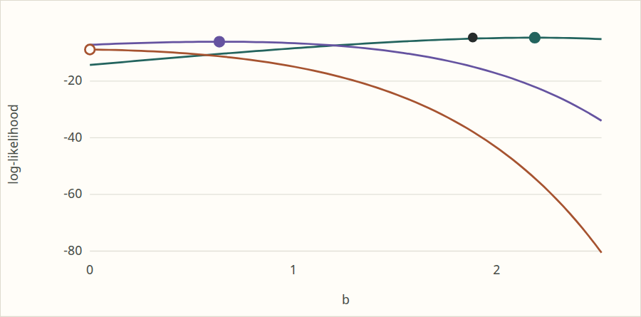

# Theory visualisation follow-ups — TASK-124.3

Completed 2026-11-01 in `codex/viz-polish`, based on source revision
`d8a62683b425204adcd3569ba7d1d30cc8140fc9` plus the uncommitted changes
listed below. All four requested items are complete. No commits, board edits,
package installs, sub-agents, simbox runs or changes outside this worktree were
made. No C++/R implementation, generated d/p/q/r or golden fixtures changed.

## Delivered

- Shared `niceTicks` logic now supplies every theory plot: the profile viewer,
  all four escape profiles, normal contours and the new held-rate example.
  Linear axes use steps from 1, 2, 5 × 10^k, with ticks inside the displayed
  range. Log axes use 1, 2, 5 mantissas, thinning dense sets for readability.
  Labels omit unnecessary decimal zeros. Build-time SVG and hydration call
  the same rendering functions.
- A two-parameter Gompertz example complements the normal contour. It shows
  the free fit and three rate-held likelihood curves. Two have finite fitted
  maxima; the third escapes to an exponential with its rate still held.
  Its table preserves the existing fitter diagnostic. An open circle marks
  the excluded boundary supremum; it is never returned as an estimate.
  Plot bounds include every finite fitted marker.
- The profile explanations and new example use native MathML in build-time
  HTML, including κ, λκ, ν and the Burr shape product. SVG axis labels use
  the corresponding mathematical glyphs. No client math renderer or CDN is
  required; browser checks also verify MathML with JavaScript disabled.
- Four small desktop/mobile screenshots are retained in
  [2026-11-01-viz-polish/](2026-11-01-viz-polish/), approximately 170 KiB total.

Implementation: [model and SVG rendering](../../../site/src/components/theory/model.mjs),
[new example component](../../../site/src/components/theory/Conditional.svelte),
[profile component](../../../site/src/components/theory/Viewer.svelte),
[route](../../../site/src/pages/theory/index.astro),
[numerical checks](../../../site/src/components/theory/check.mjs),
[browser checks](../../../site/src/components/theory/browser.mjs), and
[site acceptance integration](../../../site/scripts/check.py).

## Numerical evidence and limits of the illustration

The deterministic Gompertz sample is
`0.2, 0.4, 0.6, 0.8, 1, 1.2, 1.4, 1.6`.
Its fitted values (rounded for this table) are:

| Fit | a | b | Log-likelihood |
|---|---:|---:|---:|
| Free | 0.280878 | 1.88276 | −4.60280 |
| a held at 0.2 | 0.2 | 2.18779 | −4.68039 |
| a held at 1 | 1 | 0.636632 | −6.09681 |
| a held at 2 | 2 | → 0, excluded | supremum 8 log(2) − 14.4 ≈ −8.85482 |

The canonical [Gompertz dossier](../../../univariateML-cpp/include/cppunivariate/distributions/gompertz/README.md)
declares an exponential limit with `fixed: [a]`, status `Overdispersed`,
and `firmness: numerical`. Its held-rate criterion is
`sum(x) <= a * sum(x^2) / 2`. Here the sums are 7.2 and 8.16, so the
threshold is approximately 1.76471: the displayed held rates straddle it.
The page keeps this evidence grade explicit. The new check confirms that this
conditional limit is declared in the dossier-derived catalog.

Each curve evaluates the existing binding log density at 81 b values.
The value at b = 0 is the analytic fixed-rate exponential log-likelihood
`n log(a) − a sum(x)`, rather than a call with an invalid Gompertz coefficient.
In particular, a freely fitted exponential would make a different comparison.
The finite fits come from the existing held fitter; no grid maximum, capped
search or new optimiser is used. The figure is an illustration, not a new
proof of existence, uniqueness, monotonicity or global optimality.

Checks require finite held likelihoods to be no greater than the free
likelihood (allowance 1e-8), sampled curves to be no greater than their fitted
maxima (1e-8), and every sampled positive-b value on the escaping face to be
below its analytic boundary value. All finite b markers must lie inside the
plot. The shared tick tests cover negative, mixed-sign, small-decimal and
logarithmic ranges. Static/live SVG equality covers the new example as well
as the five existing profiles and normal contours. These checks validate
presentation and these examples; they are not independent validation of the
underlying fitters.

## Final validation

All commands completed in the foreground on the local workstation through
`/tmp/umvl-cpu/run4`; shared-slot waits were allowed to finish. The wrapper
sets `OMP_NUM_THREADS=1`, `OPENBLAS_NUM_THREADS=1`, `MKL_NUM_THREADS=1`, four
build threads and `nice -n 10`. Temporary files remained worktree-local:

```sh
export TMPDIR=$PWD/build/tmp JUST_TEMPDIR=$PWD/build/tmp
export XDG_RUNTIME_DIR=$PWD/build/tmp
/tmp/umvl-cpu/run4 just js-build
/tmp/umvl-cpu/run4 just js-test
/tmp/umvl-cpu/run4 just site-check
```

Dependencies were copied once from the main checkout's existing
`site/node_modules`, as instructed; nothing there was edited.

| Final command | Machine | Result |
|---|---|---|
| `just js-build` | Local | Pass, complete binding build |
| `just js-test` | Local | 400 passed; 0 failed, cancelled or skipped |
| `just site-check` | Local | Pass, including theory numerical/browser checks, existing inference checks, links, graph and 98 C++17 snippets compiling and linking |

The first site-check passed. Visual inspection then found that the initial
fixed b range omitted the a = 0.2 fitted marker. The range now expands to
include every finite fit, with a regression assertion. The complete site-check
was rerun after this correction and passed at approximately 15:30 Oslo time.
No binding changes followed its passing build and 400-test run.

Environment: site Node dependency 22.23.4, Python 3.14.5, SymPy 1.14.0,
g++ 15.2.0, and installed BH headers. Logs are
`build/scratch/viz-polish-js-build.log`, `viz-polish-js-test.log`,
`viz-polish-site-check.log` and `viz-polish-site-check-final.log`.
`git diff --check` passed. Native C++ and R suites were not rerun for these
site-only changes; the task's three final commands all passed. No permitted
failures or skipped checks were introduced.

Browser coverage includes desktop 1280 × 1050 and mobile 390 × 844,
no horizontal overflow, all gallery recomputations, the new example's
recomputation, profile family changes, pasted data, seeded simulation,
reset, invalid-input figure preservation, normal held-face edits,
seven default SVG figures without JavaScript, native MathML without
JavaScript and no page errors.

## Retained screenshots

All four images were inspected after the final build. The held-face images
show all three finite fit markers and the excluded boundary. The profile
screenshots show the controls and responsive page layout.

- [Desktop profile page](2026-11-01-viz-polish/desktop-page.png)
- [Mobile profile page](2026-11-01-viz-polish/mobile-page.png)
- [Desktop Gompertz held faces](2026-11-01-viz-polish/desktop-held-face.png)
- [Mobile Gompertz held faces](2026-11-01-viz-polish/mobile-held-face.png)



Open requested items: none. The dossier's numerical evidence grade remains
unchanged; the finite plots establish no additional mathematical guarantees.

Artifact-pane delivery was attempted with the prescribed `bin/show` command.
The viewer returned HTTP 403 because this worktree is outside its configured
readable roots. The report and images remain available in this worktree;
viewer configuration and files outside the worktree were not changed.
