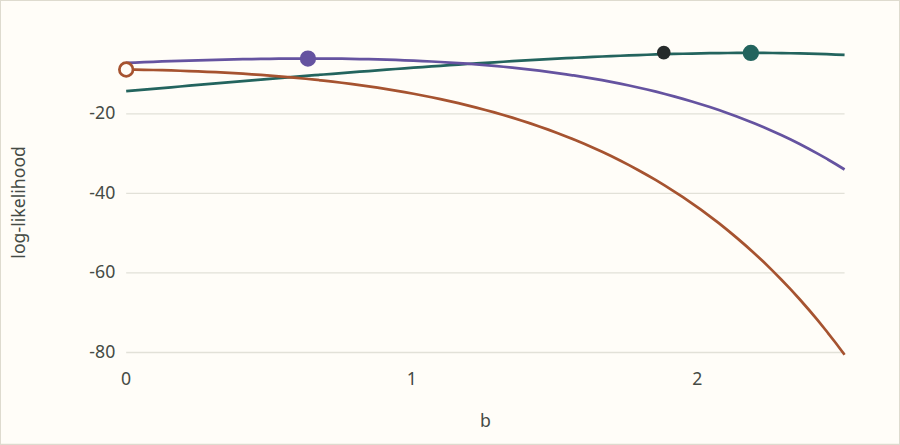
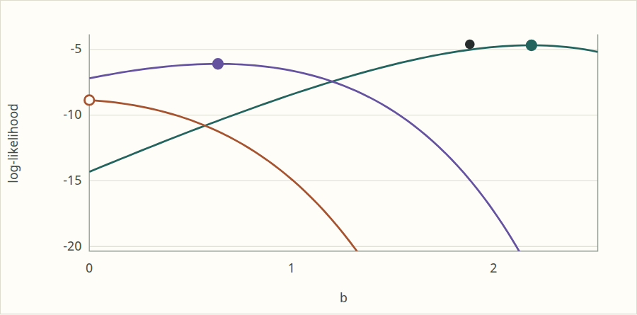
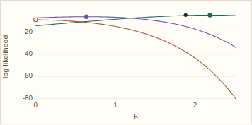
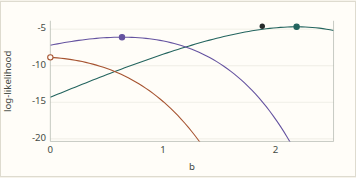
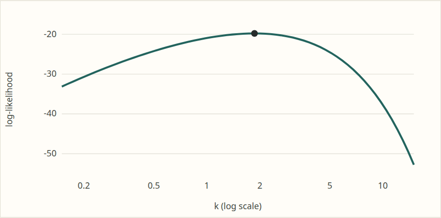
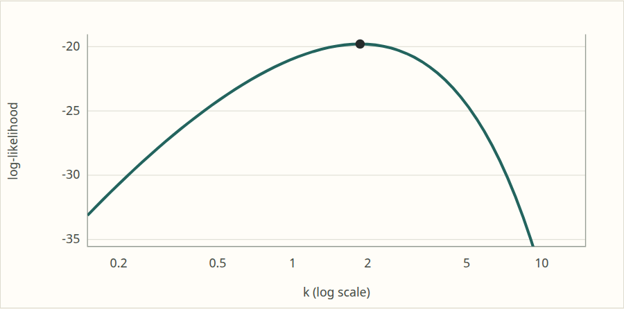
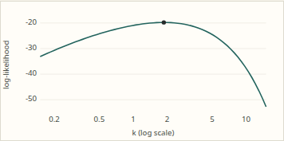
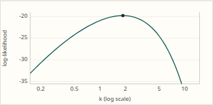

# TASK-124.3: likelihood display clipping

Completed 2026-11-02 in `codex/viz-clip`, based on
`62645f904d748001d3ee2d04cde53d29e65feddb`, with the uncommitted changes described below.
No commits, board edits, installs, or changes outside this worktree were made.

## Display rule

Profile curves and Gompertz held-rate curves now use the top **15 log-likelihood
units** below the largest finite plotted value, including fitted maxima and
limit likelihoods. If the evaluated range is narrower, keep that narrower range.
Expand the lower bound when necessary to retain every fit/limit annotation.
Add padding of 5% of the retained span, with a minimum of 0.5 units, so marker
circles clear the top and bottom edges. Decimal 1/2/5 ticks remain in use.

Each curve is clipped by an SVG clipping rectangle to the plot interior. A
visible side/bottom frame shows where the low tails terminate; the curves do
not continue into the tick labels or margins. Markers are drawn separately,
so the Gompertz open circle at the excluded `b = 0` boundary remains whole.
The accompanying caption explains the window and its marker-preserving expansion.

`model.mjs` supplies the same SVG renderer at build time and after hydration.
`Viewer.svelte` and `Conditional.svelte` add the display explanation. The normal
contour figure has mean and standard-deviation axes, not a likelihood y-axis,
and retains its existing parameter range and likelihood contour levels.
The optional full-range toggle was omitted; the numerical tables and samples
remain available. Fits, grids, likelihood values, defaults and goldens are unchanged.

This is a display rule, without a likelihood-ratio or confidence-region
interpretation. It establishes no new mathematical maximum or escape claim.
The existing finite grids remain numerical illustrations.

## Validation

All final runs completed successfully **on the local workstation** through
`/tmp/umvl-cpu/run4`, under `nice`, with BLAS/OpenMP threads pinned by the slot
wrapper. Baseline build and capture used `/tmp/umvl-cpu/run`. No simbox runs.
The slot queues were allowed to finish without interruption.

Environment: Linux 7.0.0-38-generic x86_64, Node 22.23.4, R 4.6.1,
GCC 15.2.0. Temporary and just runtime directories were `build/tmp`.

| Final command | Result |
| --- | --- |
| `just site-check` | Pass, including full site build, numerical theory checks and Playwright theory checks |
| `just js-test` | 413 passed; 0 failed, cancelled or skipped |
| `just cpp-test` | 106/106 dev shards passed |
| `just test` | R dev: FAIL 0, WARN 0, SKIP 151, PASS 20275 |
| `git diff --check` | Pass |

The R skips are tests requiring the full tier. Full R and no-long-double C++
runs were not required for this presentation-only change. No fitter, d/p/q/r,
or test-tier infrastructure was modified.

The theory checks cover all five preset profiles and Gompertz static/live SVG
equality; finite coordinates; clip-path references on every likelihood curve;
fit-marker centres between SVG y = 41 and 254 inside the y = 35 to 260 frame;
15-unit clipping; low-marker expansion; and constant likelihoods. Existing
nice-tick, numerical fit, limit-approach and failed-fit-gap checks still pass.
No numerical tolerances for fits were changed.

Playwright checks cover 1280 × 1050 desktop and 390 × 844 mobile viewports,
hydration, four escape-gallery recomputations, family changes, pasted samples,
invalid input retaining the last figure, simulation reproducibility with seed
20261101, reset, held-fit changes, and no horizontal overflow or page errors.
New comparisons require exact DOM SVG equality after Gompertz recomputation
and between JavaScript-disabled presets and live/reset figures. Numerical
checks also require exact generated SVG inclusion in the static HTML.

Reproduction, from the worktree root:

```sh
mkdir -p build/tmp build/scratch
export TMPDIR=$PWD/build/tmp JUST_TEMPDIR=$PWD/build/tmp XDG_RUNTIME_DIR=$PWD/build/tmp
/tmp/umvl-cpu/run4 just site-check
/tmp/umvl-cpu/run4 just js-test
/tmp/umvl-cpu/run4 just cpp-test
/tmp/umvl-cpu/run4 just test
```

Local logs are in `build/scratch/final-{site-check,js-test,cpp-test,r-test}.log`.
The retained evidence below does not depend on those ignored logs.

## Visual evidence

These are element screenshots of the real built page, before the renderer
change and after the final build. All eight PNGs total approximately 150 KiB.
Visual review confirmed that the Gompertz maxima are separated clearly,
low tails stop at the frame, the excluded-boundary open circle stays visible,
and the Gamma profile remains legible at both widths.

| Plot / viewport | Before | After |
| --- | --- | --- |
| Gompertz, desktop |  |  |
| Gompertz, mobile |  |  |
| Gamma profile, desktop |  |  |
| Gamma profile, mobile |  |  |

Open items: none required by this job. The optional full-range toggle is not implemented.

Presentation limitation: the artifact viewer's `show` command rejected this
worktree with HTTP 403 because its path is outside the viewer's configured
readable roots. The report and all screenshots are saved at the paths above;
no viewer configuration or files outside the worktree were changed.
