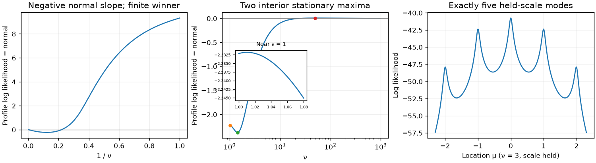

# TASK-140: closure and maximum likelihood for location–scale Student t

Research on `codex/t-closure`, based on
`54b0d06a3e447f944940fc0dd4b5b87235d2acc2`, completed 4 November 2026.
All C++/R development and full suites and the final research checks finished
green before this report was written. The changes consist of this report and
its [small evidence directory](2026-11-04-t-closure-data/README.md).
No library, binding, production test, dossier, golden, truth fixture, roadmap,
status file or NEWS source was changed. No commit was made.

## Results and scope

The mathematical problem is substantially simpler after separating shape from
location and scale:

* **At every fixed ν ≥ 1, the joint location–scale objective is geodesically
  convex.** Under the strict tie condition its maximum exists and is unique.
  This is a joint result; a location slice with scale held can have arbitrarily
  many modes as the number of distinct observations grows.
* The only proper nondegenerate missing laws are normal for restricted `lst`,
  and normal plus location–scale t₂ for `std`. Point-mass collapses are outside
  the Hellinger closure but must still enter the sample-likelihood analysis.
* In the bounded regime a finite MLE exists **if and only if a finite point
  reaches or exceeds the best missing-boundary value** specified below.
  Equality matters: an existence argument proves that finite `lst` maxima
  tied exactly with normal occur.
* The normal inward slope is a sample excess-kurtosis statistic. Its sign is
  local. An exact feasible example with kurtosis below three nevertheless has
  an attained finite `lst` MLE. Vanishing first-order slopes need higher terms;
  examples below have either sign at second order and, when that also
  vanishes, either sign at third order.
* Critical ties produce a logarithmic cusp, not a finite seam slope.
  Explicit nuisance containment, a geodesic score-to-value bound, convex
  shape-profile chord bounds and a signed normal-tail bound supply ingredients
  for a global certificate. They are not a production implementation.

Proofs below concern the canonical continuous t density and finite fixed
samples, not inference, random-sample calibration or optimizer convergence.
Numerical full-shape stationary points are explicitly distinguished from proofs.
The [current lst dossier](../../../univariateML-cpp/include/cppunivariate/distributions/lst/README.md)
and [std dossier](../../../univariateML-cpp/include/cppunivariate/distributions/std/README.md)
retain their existing partial certification.

Fixed-shape location–scatter uniqueness is established literature, not a
novelty claim here: Kent, Tyler and Vardi's 1994
[A curious likelihood identity](https://doi.org/10.1080/03610919408813180)
connects ν ≥ 1 location–scatter fitting to scatter fitting. Its
[author-institution abstract](https://www.researchwithrutgers.org/en/publications/a-curious-likelihood-identity-for-the-multivariate-t-distribution/)
was checked; the full article was not used as a proof source. The elementary
univariate proof below is self-contained. Hasannasab et al.'s
[2021 paper](https://doi.org/10.1007/s11075-020-00959-w), Sections 3 and 5,
was also consulted: its shape-existence theorem holds location fixed, while
its iterative convergence conclusions concern critical points. Neither is a
general all-free global certificate.

## 1. Coordinates and complete distributional closure

Let n ≥ 2 observations be finite and nonconstant. Repeated observations may
instead be represented by distinct values xⱼ and integer multiplicities kⱼ;
every sum below includes those multiplicities. Let k be the largest
multiplicity. Use ordinary t scale s, not standard deviation:

$$
f_\nu(x;\mu,s)=\frac{c_\nu}{s}
 \left(1+\frac{(x-\mu)^2}{\nu s^2}\right)^{-(\nu+1)/2},\qquad
c_\nu=\frac{\Gamma((\nu+1)/2)}{\sqrt{\nu\pi}\,\Gamma(\nu/2)}.
$$

The all-free fitting spaces are ν ≥ 1 for `lst` and ν > 2 for `std`.
For the latter, its finite standard deviation is
$s\sqrt{\nu/(\nu-2)}$. Thus all-free `std` is exactly the same family of
laws restricted to ν > 2. The t₂ face has positive ordinary scale and
infinite standard deviation. Keeping standard deviation finite instead as
ν ↓ 2 collapses ordinary scale to zero.

For any a ≥ 1, the proper nondegenerate closure of ν ≥ a consists of
finite-shape t laws with ν ≥ a and normal laws. For ν > a, add the tₐ
face too. These are both the nondegenerate weak closure and the Hellinger
closure; the entire weak closure on the real line additionally contains all
point masses. In particular:

| Fitting space | Missing proper nondegenerate laws |
|---|---|
| `lst`, ν ≥ 1 | Normal |
| `std`, ν > 2 | Normal and location–scale t₂ |

Here is an exhaustiveness argument. Standard t quantiles extend continuously
to normal quantiles at ν = ∞, with uniformly positive interquantile width
and uniformly tight standardized laws on ν ∈ [a,∞]. Tight nondegenerate
location–scale sequences therefore have bounded location and scale bounded
above and away from zero. Extract a subsequence of those parameters and of
ν in [a,∞]; density convergence gives precisely the laws just listed.
Scheffé's lemma supplies total variation, hence Hellinger convergence.
Scale tending to zero gives a point mass when location converges. Scale
tending to infinity puts asymptotically no mass in a bounded interval,
since $\sup_x f_\nu(x;\mu,s)\le 1/(s\sqrt{2\pi})$ uniformly in ν.
Escaping location with bounded scale also fails tightness. No finite atom
plus escaped mass, partial collapse or additional proper law is possible.
On the compactified real line, the remaining limits are endpoint mixtures
$q\delta_{-\infty}+(1-q)\delta_{+\infty}$: spread tending to infinity with
an appropriate location-to-scale ratio realizes every q ∈ [0,1].
Point masses are not limits in Hellinger distance, even upon enlarging the
dominating measure.

Without the `lst` fitting restriction, every nonconstant sample has unbounded
likelihood: fix location at any observation and choose sufficiently small
positive ν before collapsing scale. None of the results below silently
extends the all-free problem to ν > 0.

## 2. Fixed-shape global geometry and uniqueness

Put $b=\sqrt\nu s$, $w=\mu+ib$ and
$K_\nu=\Gamma((\nu+1)/2)/(\sqrt\pi\Gamma(\nu/2))$.
Apart from its shape-only constant, negative log likelihood is

$$
F_\nu=\frac{\nu+1}{2}\sum_i B_{x_i}(w)
       +\frac{n(\nu-1)}2 B_\infty(w),\qquad
B_x=\log\frac{(x-\mu)^2+b^2}{b},\quad B_\infty=-\log b.
$$

All coefficients are nonnegative for ν ≥ 1. On the upper half-plane's
vertical unit-speed geodesic, $b=e^t$, each finite B is
$\log(e^t+(x-\mu)^2e^{-t})$, hence convex. On a circular geodesic,

$$
\mu=c+r\tanh t,\qquad b=r/\cosh t,
$$

it is $\log(A\cosh t-B\sinh t)$ with
$A=((x-c)^2+r^2)/r$, $B=2(x-c)$ and second derivative
$(A^2-B^2)/(A\cosh t-B\sinh t)^2\ge0$.
Also $B_\infty=\log\cosh t-\log r$ is strictly convex on that circle.
Consequently, for ν > 1 and two distinct observations, F is strictly convex
along every connecting geodesic: circular paths get strictness from
$B_\infty$, vertical paths from at least one nonzero residual. At ν = 1,
three distinct values suffice. Any exact stationary point in these cases
is the unique global maximum of likelihood, because any other point has a
connecting geodesic with strictly increasing F away from stationarity.
The ordinary-coordinate Hessian at a stationary point is positive definite
for F, since the geodesic Hessian is positive definite there.

Boundary analysis gives the complete fixed-ν classification for ν ≥ 1:

| Largest multiplicity | Outcome |
|---|---|
| $k<\nu(n-k)$ | Unique attained positive-scale maximum |
| $k>\nu(n-k)$ | Unbounded likelihood |
| $k=\nu(n-k)$, ν > 1 | Finite unattained collapse supremum |
| $k=n/2$, ν = 1, at least three distinct values | Finite unattained collapse supremum |
| Two equally frequent values, ν = 1 | Attained continuum of maxima |

The strict case is coercive: all boundary likelihoods vanish. The equality
proof and its exception are given next. Thus multistart is not mathematically
needed to choose between different joint nuisance maxima at a fixed ν ≥ 1.
This does not prove convergence of EM, Newton or BFGS from arbitrary starts.

## 3. Collapse values, equality and the critical cusp

At an observed value z of multiplicity k_z, scale collapse with μ = z gives

$$
L_\nu\sim c_\nu^n\nu^{(\nu+1)(n-k_z)/2}
 s^{\nu(n-k_z)-k_z}\prod_{x_i\ne z}|x_i-z|^{-(\nu+1)}.
$$

A displacement $(\mu-z)/s$ with a nonzero limit reduces this leading value;
unbounded displacement cannot improve it. At the critical equality
$k_z=a(n-k_z)$ the best collapse value is

$$
B_{a,z}=K_a^n\prod_{x_i\ne z}|x_i-z|^{-(a+1)}.
$$

This is a limit of density products, not a likelihood assigned to a Dirac law.
To prove it bounds the entire fixed-a likelihood, invert the half-plane:
$v=-1/(w-z)=u+it$. Direct substitution and
$|1+(x_i-z)v|\ge |x_i-z|t$ yield

$$
L_a(w)\le B_{a,z}\left(\frac{t}{|v|}\right)^{(a-1)n}\le B_{a,z}.
$$

For a > 1, equality would require both u = 0 and
$u=-1/(x_i-z)$, impossible. For a = 1, equality requires every observation
other than z to have the same value. In that balanced two-point case,
with values z < y, the maximizing semicircle is
$s^2=(\mu-z)(y-\mu)$ between the two values. Otherwise the bound is
approached only at collapse. This proves all equality rows above.

For the free-shape problem, use the lower endpoint a = 1 or 2. If
$k>a(n-k)$, choose an allowed finite ν below k/(n-k) and collapse: the
supremum is infinite. If equality holds, a joint approach ν ↓ a and s ↓ 0
can contribute at most $B_{a,z}$. Its extra factor is
$s^{(\nu-a)(n-k)}$, at most one for sufficiently small s; it cannot create
a new larger boundary value. Strict subthreshold multiplicities give zero
at every finite-shape collapse.

There is a sharper local description at a critical tie. Write r = n − k_z,
$d_i=x_i-z\ne0$ and

$$
S_1=\sum_{x_i\ne z}d_i^{-1},\quad
S_2=\sum_{x_i\ne z}d_i^{-2},\quad
D_a=\frac{a(a+1)}2\left(S_2-\frac{S_1^2}{k_z}\right).
$$

Dₐ is positive for a > 1. For a = 1 it is positive unless the sample is
the balanced two-point exception, by Cauchy–Schwarz. For ε = ν − a ↓ 0,
the unique nuisance optimum obeys

$$
 s^2\sim\frac{r\epsilon}{2D_a},\qquad
 \mu-z\sim\frac{aS_1}{k_z}s^2,
$$

and its optimized log likelihood satisfies

$$
P(a+\epsilon)=\log B_{a,z}
       +\frac r2\epsilon\log\epsilon+C_a\epsilon+o(\epsilon).
$$

For an explicit linear term, define

$$
J(\nu)=n\log c_\nu+\frac{(\nu+1)r}{2}\log\nu
 -(\nu+1)\sum_{x_i\ne z}\log|d_i|,
\qquad
C_a=J'(a)+\frac r2\log\frac{r}{2D_a}-\frac r2.
$$

Proof: expand at μ = z + δ. The location score gives
$\delta\sim as^2S_1/k_z$. After substituting this, log likelihood is
$J(\nu)+r\epsilon\log s-D_as^2+o(s^2)$ to first relevant order.
The scale score then gives the displayed s². Exhaustion of the fixed-a
boundary and its strict nonattainment force the optimizing sequence into
this expansion; the location score first implies δ = O(s²).
Thus $P'(a+\epsilon)\to-\infty$: the critical collapse is locally stable.
The [80-digit checks](2026-11-04-t-closure-data/verification.json) verify both
scale and value constants for (0,0,1,100) at a = 1 and
(−1,0,0,0,0,1) at a = 2 down to ε = 10⁻¹².

## 4. Nuisance containment and the exact attainment criterion

Let R be the data range and δ the smallest gap between distinct values.
For fixed ν with strict tie inequality, every nuisance optimum has

$$
 x_{\min}<\widehat\mu_\nu<x_{\max},\qquad
 \frac\delta2\sqrt{\frac{n-k-k/\nu}{n}}
 \le\widehat s_\nu\le R\sqrt{1+1/\nu}.
$$

The location score excludes both exterior rays. The scale equation is

$$
n=\sum_i\frac{(\nu+1)(x_i-\mu)^2}
                    {\nu s^2+(x_i-\mu)^2}.
$$

At most k observations have distance less than δ/2 from any μ. Applying
the equation to the other n − k gives the lower bound; bounding every
squared residual by R² gives the upper bound. These are uniform for
ν ≥ V whenever $V>k/(n-k)$. In particular, conditional optima at
ν → ∞ stay in a compact nuisance rectangle and converge to the unique
normal fit. Write

$$
\bar x=n^{-1}\sum_i x_i,\quad v=n^{-1}\sum_i(x_i-\bar x)^2,\quad
N=-\frac n2\log(2\pi e v).
$$

All escapes with likelihood relevant to the supremum are now exhausted.
In the bounded regime define the missing-boundary log value H by:

| Model and ties | H |
|---|---|
| `lst`, k < n/2 | N |
| `lst`, k = n/2 | $\max(N,\max_z\log B_{1,z})$ over critical atoms |
| `std`, k < 2n/3 | $\max(N,T_2)$, where $T_2=\max_{\mu,s}\ell(2,\mu,s)$ |
| `std`, k = 2n/3 | $\max(N,\max_z\log B_{2,z})$ |

For each row, **a finite MLE in the specified fitting space exists iff some
finite allowed point has log likelihood ≥ H**. If a point beats H, a
maximizing superlevel set cannot escape and a maximum is attained. If a
finite point equals H, either the supremum is H and that point maximizes,
or another point beats H and the preceding argument applies. The converse
is immediate because each missing-boundary value is approachable.
For `std`, a finite-scale t₂ optimum is unique in the strict row, by Section 2.
No optimization cap or sampled profile grid enters this criterion.

## 5. Normal seam: first, second and third orders

Use ξ = 1/ν and $z_i=(x_i-\bar x)/\sqrt v$, with empirical moments
$m_j=n^{-1}\sum_i z_i^j$. These use variance divisor n, not an unbiased
sample variance or a bias-corrected kurtosis estimator. The optimized
location–ordinary-scale profile has expansion

$$
P(1/\xi)=N+A\xi+Q\xi^2+O(\xi^3),
\qquad A=\frac n4(m_4-3),
$$

$$
Q=n\left\{\frac{m_4}{4}-\frac{m_6}{6}
       +\frac{m_3^2}{2}+\frac{(1-m_4)^2}{4}\right\}.
$$

For a fixed standardized residual z, the log-density coefficients are

$$
a(z)=\frac{z^4-2z^2-1}{4},\qquad
b(z)=\frac{z^4}{4}-\frac{z^6}{6},\qquad
c(z)=\frac1{24}-\frac{z^6}{6}+\frac{z^8}{8}.
$$

The normal nuisance negative Hessian in $(\mu,\log s)$ is
$\operatorname{diag}(n/v,2n)$. The gradient of $\sum a(z_i)$ is
$(-nm_3/\sqrt v,n(1-m_4))$. Adding half its squared inverse-Hessian norm
to $\sum b(z_i)$ gives Q. This is an optimization Hessian of the total
log likelihood, not an inference information calculation. Also

$$
\widehat\mu=\bar x-\sqrt v\,m_3\xi+O(\xi^2),\qquad
\log\widehat s=\tfrac12\log v+\tfrac12(1-m_4)\xi+O(\xi^2).
$$

In standard-deviation coordinates the first density coefficient is
$(z^4-6z^2+3)/4$ instead; its fitted-normal sample sum is the same A.

Positive A excludes normal as the global supremum. Negative A makes normal
locally stable but supplies no global conclusion. If A = 0, Q decides the
first nonzero second-order behavior. For example:

| Values | Multiplicities | A | Q |
|---|---|---:|---:|
| −1, 0, 1 | 1, 4, 1 | 0 | 3/2 |
| −2, −1, 0, 1, 2 | 1, 2, 6, 2, 1 | 0 | −1 |

Both are bounded `std` samples. Neither sign follows from kurtosis three.
For symmetric standardized data with $m_4=3$ and $m_6=21/2$, A = Q = 0,
and the cubic coefficient is

$$
P(1/\xi)-N=\frac n8(m_8-39)\xi^3+O(\xi^4).
$$

This follows by profiling log scale: its first displacement is −ξ,
and the cubic coefficient is
$\sum c+B'(-1)+A''/2+\ell_0'''(-1)^3/6$.
Two explicit samples show both signs. Values
$(-\sqrt{15}/2,-1,0,1,\sqrt{15}/2)$ with multiplicities
(32,45,176,45,32) give $m_8=309/8$ and cubic coefficient −15.46875.
Values $(-\sqrt6,-\sqrt3,-1,0,1,\sqrt3,\sqrt6)$ with multiplicities
(1,15,9,70,9,15,1) give $m_8=42$ and coefficient 45.
Both have variance one and admissible `std` tie fractions. Their exact
radical definitions, not rounded displayed decimals, are used in verification.
The high-precision checks recover these coefficients using ν = 100 through
100,000. They corroborate the analytic expansions; they are not a global
shape search at a large cap.

## 6. The t₂ seam and exact examples

When k < 2n/3, the unique t₂ nuisance optimum has a smooth inward profile.
The scale score simplifies the envelope derivative at every strict fixed-ν
optimum to

$$
P'(\nu)=\frac n2\{\psi((\nu+1)/2)-\psi(\nu/2)\}
 -\frac12\sum_i\log\left(1+\frac{(x_i-\widehat\mu_\nu)^2}
                                      {\nu\widehat s_\nu^2}\right).
$$

Thus $S_2=P'(2+)$ is explicit after a unique global nuisance fit. Positive
S₂ excludes the t₂ face. Negative S₂ makes it locally stable, without a
global conclusion. A positive normal inward coefficient together with positive
S₂ guarantees finite `std` attainment: whichever boundary is higher can be
strictly improved by an allowed finite point. Critical ties require the cusp
of Section 3 instead of this smooth formula.

**An exact attained `std` example.** Values (−3,−1,0,1,3) with
multiplicities (1,4,6,4,1) have $m_4=680/169>3$. Symmetry forces μ = 0.
At ν = 2 the squared b solves $8b^4+41b^2-63=0$, so
$1.23<b^2<1.24$. Hence the average log term in the derivative is less than
$(8(0.6)+2(2.12))/16=0.565$, while
$\psi(3/2)-\psi(1)=2-2\log2>0.612$.
Therefore $S_2>0.376$. The bounds on the three logarithms are proved in the
reproducer by exact rational positive Taylor sums for exp through degree 20.
Both missing faces improve, so a finite `std` maximum exists. This proves
attainment without declaring an unchecked optimizer output to be the MLE.

**A locally stable t₂ face can lose.** For (−1,0,1) with multiplicities
(1,3,1), symmetry gives $\widehat s_\nu^2=2/5-3/(5\nu)$.
At ν = 2, S₂ is approximately −0.257495, but $T_2-N=-0.0134537$.
A finite ν = 100 point on this explicit profile already beats T₂.
Thus the negative inward derivative cannot certify global t₂ selection.

**Critical collapse can be the global `std` supremum.** For
(−1,0,0,0,0,1),

$$
\widehat\mu_\nu=0,\qquad
\widehat s_\nu^2=\frac{\nu-2}{3\nu},\qquad
\widehat{\mathrm{sd}}_\nu=1/\sqrt3.
$$

The profile derivative divided by n/2 is
$\psi((\nu+1)/2)-\psi(\nu/2)-\frac13\log((\nu+1)/(\nu-2))<0$
for every ν > 2. Indeed the integral kernels compare as

$$
\frac{e^{2t}-e^{-t}}{3t}>\frac2{1+e^{-t}},\qquad t>0,
$$

because $2\sinh(2t)+2\sinh t>6t$. Thus the supremum is exactly
$B_{2,0}=1/64$, log value $-6\log2$, and is unattained in `std`.
Even the optimized t₂ face has no positive-scale maximizer in this example.

**Balanced two-point data have only the normal all-free supremum.**
After translation and scaling take equally frequent −d and d. For ν > 1,
uniqueness and symmetry give μ = 0 and s = d. Its profile derivative is

$$
\frac n2\left\{\psi((\nu+1)/2)-\psi(\nu/2)
                         -\log(1+1/\nu)\right\}>0.
$$

The integral comparison is $2/(1+e^{-t})>(1-e^{-t})/t$, equivalent to
$2t>1-e^{-2t}$. At ν = 1 the Cauchy semicircle has the same profile value
as its midpoint. Thus neither all-free `lst` nor `std` attains a maximum on
balanced two-point data, despite the attained fixed-Cauchy continuum.

## 7. Global bounds without a shape cap

### Conditional values from a score residual

At fixed ν satisfying the strict tie inequality, let L and U be the scale
bounds of Section 4. A candidate inside that rectangle has hyperbolic
score norm and a distance bound

$$
g=\sqrt{\nu s^2 U_\mu^2+U_{\log s}^2},\qquad
D=\operatorname{arcosh}\left(1+
 \frac{R^2+\nu(U-L)^2}{2\nu L^2}\right).
$$

Geodesic convexity gives the exact value enclosure
$\ell(\mu,s,\nu)\le P(\nu)\le\ell(\mu,s,\nu)+gD$.
It does not require a global strong-convexity constant. The research solver
checks its total score and containment before reporting any conditional
point and records this value-gap bound. On the chord workload the largest
computed gD was $2.24\times10^{-10}$.

### A convex correction and chord upper bounds

In coordinates (μ,b), log likelihood is $n\log K_\nu+\nu A_0+B_0$,
where $A_0=-\frac12\sum_i\log(1+(x_i-\mu)^2/b^2)$ and B₀ is independent
of ν. Therefore

$$
G(\nu)=P(\nu)-n\log K_\nu
$$

is convex and nonincreasing, being a supremum of affine nonincreasing
functions. For α ≤ ν ≤ β, its chord gives

$$
P(\nu)\le n\log K_\nu+
 \frac{\beta-\nu}{\beta-\alpha}[P(\alpha)-n\log K_\alpha]
 +\frac{\nu-\alpha}{\beta-\alpha}[P(\beta)-n\log K_\beta].
$$

Endpoint upper enclosures can replace exact values. The right side is a
concave scalar function because $(\log K_\nu)''<0$, so its maximum is
located by the monotone derivative or an endpoint. This is a finite-interval
global upper bound, rather than a grid nomination rule. It also explains
why a general shape-concavity argument fails: $P''=n(\log K)''+G''$
combines negative and nonnegative terms. No sign follows.

### An explicit signed normal-tail bound

Choose V ≥ 1 with $V>k/(n-k)$. Define uniform nuisance bounds

$$
L=\frac\delta2\sqrt{\frac{n-k-k/V}{n}},\quad
U=R\sqrt{1+1/V},\quad Z=R/L,\quad s_N=\sqrt v,
$$

$$
c=\frac{n s_N^2}{2U^2},\qquad
M=n\sqrt{(s_N/L)^2(Z+Z^3)^2+(Z^2+Z^4)^2},
$$

$$
C=n\left(\frac{Z^4}{4}+\frac1{24V}\right)+\frac{M^2}{4c}.
$$

Then, for $0<\xi\le1/V$,

$$
P(1/\xi)\le N+A\xi+C\xi^2.
$$

Here are the needed inequalities. The gamma ratio has the global remainder

$$
-\frac1{4\nu}\le\log c_\nu+\tfrac12\log(2\pi)
 \le-\frac1{4\nu}+\frac1{24\nu^3}.
$$

Its integral representation is
$-\frac12\int_0^\infty e^{-\nu t}\tanh(t/2)/t\,dt$; use
$t/2-t^3/24\le\tanh(t/2)\le t/2$.
Also $\log(1+u)\ge u-u^2/2$ for u ≥ 0. Thus each density's log difference
from its normal counterpart is at most
$\xi a(z)+\xi^2 z^4/4+\xi^3/24$.
For $h=((\mu-\bar x)/s_N,\log(s/s_N))$, normal likelihood loses at least
$c\|h\|^2$ on the containing rectangle. The gradient of the total a term
is bounded by M there, so that term is at most $A+M\|h\|$.
Maximizing $-c\|h\|^2+\xi M\|h\|$ gives the formula for C.

If A < 0, every $\xi\le\min(1/V,-A/(2C))$ is strictly worse than normal.
If a finite incumbent beats N, the same bound eventually excludes the tail
regardless of A. This is a genuine signed bound, not a decision made at ν =
100,000. Its constants are deliberately conservative: for the next example
it excludes the normal-side tail only beyond approximately $1.98\times10^{16}$.
It demonstrates a finite exclusion, not a practical production stopping rule.
Tighter nuisance containment would be essential for speed.

## 8. Failures of local rules, including exact normal ties

**Negative normal slope, attained finite `lst` maximum.** Take nine zeros,
six ones and five tens. Here $v=17.46$, $m_4=2.30490901146<3$,
$A=-3.47545494267$ and $N=-56.9778961682080$.
The explicit allowed point $(\mu,s,\nu)=(1/2,1/2,1)$ has
$\ell=-48.8870828733171$, beating normal by 8.09081329489.
The sign needs no optimizer or high-precision assumption: its likelihood is
$\pi^{-20}181^{-5}$, and its likelihood ratio to optimized normal is
$\{(873e/(25\pi))^2/181\}^5>1$. Indeed e > 2 and π < 4 make the
quantity being squared greater than 873/50, whose square exceeds 181.
Since k = 9 < n/2, normal is the only missing likelihood face. The attainment
theorem proves a finite MLE exists. The witness need not itself be the MLE;
the unique optimized Cauchy value is still higher. This counterexample uses
integer data and a fixed feasible point, not a numerical global search.
By continuity its strict inequalities persist after sufficiently small
perturbations that remove every tie.

For `std`, seven −1s, twenty-six zeros and seven +1s have
$m_4=20/7<3$, yet the allowed ν = 2.01 point on the explicit symmetric
profile beats normal by approximately 3.92643. This excludes normal but
**does not establish finite `std` attainment**: its t₂ boundary value is
higher still. The full distinction is exactly why `std` must compare both
missing faces.

**Finite maxima tied exactly with normal really occur for `lst`.** Consider
20 observations with values $(0,1,u,1+9u)$ and multiplicities (9,5,1,5),
0 ≤ u ≤ 1. At u = 0 they are balanced two-point data, whose all-free
supremum is normal and is strictly above every bounded-shape candidate and
the Cauchy collapse value. At u = 1 they are the preceding finite-winner
sample. Throughout the path,

$$
v(u)=\frac14+\frac{11}5u+\frac{1501}{100}u^2,
$$

$$
3v(u)^2-\frac1n\sum_i(x_i-\bar x)^4
=\frac18+\frac{11}5u+\frac{363}{25}u^2
 +\frac{5333}{125}u^3+\frac{761953}{5000}u^4>0.
$$

Hence the normal slope is uniformly negative on this compact path. A uniform
version of the signed bound excludes all sufficiently large ν. Uniform
nuisance containment for that tail follows from the two separated data groups,
without using the smallest individual spacing as u ↓ 0. At u = 0 any
bounded-shape nuisance collapse has limiting likelihood at most the balanced
Cauchy value, strictly below normal; all other nuisance escapes vanish.
Consequently all bounded-shape likelihoods remain strictly below normal for
small positive u. For u > 0 the largest tie has multiplicity 9, so bounded
shape superlevel sets are compact and vary continuously with u. The maximum
over the remaining finite shape interval must therefore cross normal at some
$u_*\in(0,1)$. At its first crossing a finite point attains N, while every
finite point is at most N and the tail is strictly below N. This is a finite
MLE tied with normal. This proof establishes existence; it does not supply
an isolated numerical value of u* or assert that the tying shape is Cauchy.

**Two locally stable ends need not describe the intervening profile.**
For (−1,0,1) with multiplicities (51,98,51), the Cauchy derivative divided
by n/2 is $2\log2-(51/100)\log51<0$, while the normal inward slope is also
negative because $m_4=100/51<3$. Both ends are locally stable, with an
intervening minimum. Endpoint derivative signs are not a unimodality proof.
The retained 55-observation numerical example additionally has a locally
stable Cauchy fit but an interior candidate near ν = 33.9054 with likelihood
−77.96128, above both Cauchy (−83.65806) and normal (−78.04162).

## 9. What multimodality in location means

With ν and s held, the location score is proportional to

$$
\sum_{j=1}^m k_j\frac{x_j-\mu}{b^2+(x_j-\mu)^2}.
$$

Its denominator is positive and its numerator has degree 2m − 1, with
leading coefficient −n. Thus there are at most 2m − 1 distinct stationary
locations and at most m isolated local maxima. For sufficiently small b,
each distinct observation has a nearby strict maximum: balancing its
$-k_j(\mu-x_j)/b^2$ score against the bounded remaining terms gives a
root with displacement O(b²) and negative slope. These m maxima already
force m − 1 intervening minima, saturating the polynomial degree bound.
For two equally frequent points ±d, the held-scale maxima are exactly
$\mu=\pm\sqrt{d^2-b^2}$ when b < d; the center is then a minimum.

The retained five-point example uses x = (−2,−1,0,1,2), b = 1/20 and
ν = 3, so ordinary scale is $1/(20\sqrt3)$. Exact rational polynomial root
isolation finds nine simple real roots, in boxes of width at most 10⁻²⁴:
there are exactly five maxima, near −1.994722, −0.997902, 0, 0.997902 and
1.994722. This is an exact root-count certificate for a held-scale slice.

When scale is optimized and the strict fixed-shape tie condition holds, the
scale maximum at each location is unique, by its strictly decreasing
log-scale score. A stationary location of that scale profile is a joint
stationary point. Section 2 therefore leaves only one: the scale-profiled
location likelihood is unimodal. Holding scale and profiling scale are
mathematically different operations.

With ν also free, every full stationary point still lies on the single
nuisance curve $(\widehat\mu_\nu,\widehat s_\nu)$. Distinct full local maxima
can occur at different ν and hence different locations. The seeded survey
retains this **numerical** example, with data and all stationary coordinates
in [multimodality.json](2026-11-04-t-closure-data/multimodality.json):

| ν | μ | Ordinary scale | Total log likelihood | Full curvature |
|---:|---:|---:|---:|---|
| 1.0102899102994 | 0.641765846314 | 0.357567718834 | −46.2188967616303 | Negative definite |
| 1.4277095894994 | 0.558272089258 | 0.500253508153 | −46.3619895397879 | Saddle; profile minimum |
| 49.705241724475 | 0.019645599369 | 0.979774980989 | −43.9804627131438 | Negative definite |

Refinement used 75 decimal digits. The largest retained score residual over
both examples is below 4 × 10⁻⁷⁶. The smallest eigenvalue of the negative
Hessian at the last maximum is about 5.46 × 10⁻⁶, positive but shallow.
These Hessians use total log likelihood in (μ, log s, ν) coordinates.
High-precision stationarity and curvature are numerical evidence, not interval
root existence or global root enumeration. No scan endpoint is returned as
an estimate, and the higher retained candidate is not declared globally optimal.

## 10. Validation, limitations and remaining mathematical questions

All commands ran in the foreground on the **local workstation**, under the
shared CPU locks and nice level 10. No simbox, sub-agents, installs, board
edits or Git writes were used. The exact commands, compiler/R/BH versions,
source hash, script/input SHA256 hashes and compact results are in
[validation.json](2026-11-04-t-closure-data/validation.json).

| Final suite | Result |
|---|---|
| `/tmp/umvl-cpu/run4 just cpp-test` | 106/106 development shards passed |
| `/tmp/umvl-cpu/run4 just test` | FAIL 0, WARN 0, SKIP 153, PASS 20,511 |
| `/tmp/umvl-cpu/run4 env UMVL_TEST_TIER=full just cpp-test`{.literal-code} | 127/127 full shards passed |
| `/tmp/umvl-cpu/run4 just test-full` | FAIL 0, WARN 0, SKIP 0, PASS 43,328 |
| Research scripts under `/tmp/umvl-cpu/run` | All assertions passed; figure generated and inspected |

The development skips are tier omissions; the full R run has no skips.
C++ test times were 66.58 s development and 107.27 s full; R elapsed times
were 145.774 s development and 294.080 s full. These are run records on a
shared machine, not performance comparisons. R package generation occurred
as part of the suites; production goldens and truth tables were not regenerated.
No-long-double, JS and site suites were not run: this research-only change
alters none of their implementation or infrastructure.

The survey used NumPy seed 140, 1,500 proposals, a 65-point shape nomination
grid and score-checked conditional solves. Trial 70 supplied the stable-Cauchy
example, trial 539 the two-interior-maxima example. Nomination endpoints do
not certify root completeness. A 37-step targeted weight continuation found
no example with two interior maxima both above ν = 2; that negative search
result is retained in [continuation.json](2026-11-04-t-closure-data/continuation.json).

The final independent checks include exact rational root isolation and exp
inequalities, high-precision feasible-point likelihoods, four-scale seam
limits through cubic order, two critical-tie cusp constants, six gamma-bound
checks and 124 chord comparisons. The largest computed chord excess was
zero, with an absolute comparison allowance of 10⁻⁸. Conditional nuisance
scores must be below 10⁻⁷ in the independent solver; observed value-gap
bounds on the chord workload were below 2.24 × 10⁻¹⁰. High-precision full
stationary candidates must have score below 10⁻⁵⁵ and the stated Hessian
inertia. Scaled seam limits have explicit tolerances in
[verify.py](2026-11-04-t-closure-data/verify.py). Binary64 survey inputs are
rechecked as the exact decimal numbers retained in the JSON; the displayed
radical examples use their exact formulas at high precision.

The geometric, closure, cusp, seam and upper-bound arguments are mathematical
proofs in exact arithmetic. Their research numerical evaluations use ordinary
floating point or mpmath, with the stated comparison margins. Only the
rational checks are exact arithmetic computations. There is no outward-rounded
global interval engine, and the numerical full-shape candidates are not
advertised as certified MLEs. In particular, the production fitters' existing
caps, multistarts and face comparisons acquire no certificate from this work.

The following questions remain **open**, with the concrete gap recorded:

1. **General shape landscape and global uniqueness.** Conditional uniqueness
   does not bound the number of full-shape extrema or establish uniqueness of
   the global finite MLE. The two-maxima example has high-precision local
   evidence, not an exact root-box proof or a certified exhaustive root count.
   Producing two interior maxima both in the `std` ν > 2 domain was not
   settled by the retained survey/continuation; its absence is not proved.
2. **An efficient complete numerical certificate.** The chord and tail
   inequalities give global value bounds, but coefficient root isolation,
   profile-curvature neighborhoods, arithmetic propagation and useful sharp
   nuisance boxes have not been implemented. The explicit conservative tail
   cutoff above is too large for a practical fitter. Exact ties and higher
   vanishing seam coefficients require additional local bounds rather than
   a cap or an unchecked estimate. At critical ties, the cusp is proved but
   a computable uniform remainder for automatic lower-end pruning is missing.
3. **Isolating the normal-tie transition.** Existence of a finite normal-tied
   `lst` maximum is proved along the explicit polynomial path. Its u*, tying
   shape and full coefficient box have not been numerically isolated with
   a global certificate. A Cauchy-only crossing would not suffice, since an
   unexamined shape could be higher.

These gaps delimit the research results; they are not replaced by claims from
the green regression suites. A later production task can use the fixed-shape
geometry, conditional value bounds, shape chords and signed tail bound, while
preserving failure statuses whenever a global comparison remains unresolved.
No changes to the settled d/p/q/r, special-function seam, truth routes or
code-generation scripts are required by the present research.
