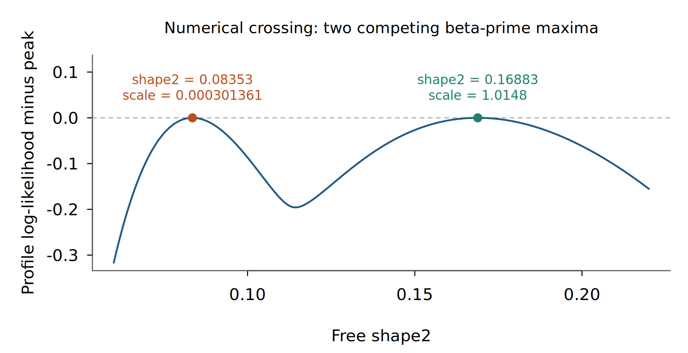

# Beta-prime conditional-profile certificates — TASK-116.32

Completed J11a: non-unit `shape1` held with `shape2` and scale free, and its reciprocal `shape2`-held problem. Successful finite fits now require a global certificate and coefficients to golden accuracy. Gamma and inverse-gamma faces, unresolved ties, exhausted budgets and numerical failures stop with structured diagnostics. Routing is in the binding-neutral fit layer, shared by R and JS.

The whole-family `fit.certified` flag remains **partial** because the three-free-parameter fitter remains numerical. Its default algorithm and the frozen goldens were preserved. No commits, board edits or dependency installations were made.

## Source and certificate

Base revision: `7c52f905f21bee7d997d59211d4093e2593ec727`, branch `codex/betapr-prof`. The final uncommitted implementation and tests are identified by the [nine-file SHA-256 manifest](2026-11-07-betapr-prof-data/source-sha256.txt).

The canonical proof, arithmetic allowances and failure behavior are in the [family dossier](../../../univariateML-cpp/include/cppunivariate/distributions/betapr/README.md#non-unit-held-shape-certificate); implementation is in [certificate.hpp](../../../univariateML-cpp/include/cppunivariate/distributions/betapr/certificate.hpp), called by the existing public held fitter.

At each free shape, the log-scale score has a unique root. The certificate encloses the resulting shape-profile derivative and its Schur-complement curvature. It excludes monotone or dominated intervals, isolates the remaining maximizer and verifies negative curvature across its coefficient enclosure. No profile-unimodality assumption is made. Explicit lower-shape and gamma-tail bounds cover the exteriors. The signed second-order tail bound can select a nonconstant gamma face; reciprocal transport supplies the inverse-gamma result while retaining the held shape.

Certification is in exact arithmetic conditional on the computed comparisons, with the dossier's practical floating-point margins. It does not claim outward-rounded interval arithmetic. A finite success requires relative shape and scale enclosures within `1e-6`; unresolved comparisons stop. Both profile points and segment bounds count toward `128 * min(iterlim, 100000)` evaluations, and inner solves use the solver budget.

Likelihood calculations inside the certificate are per observation after normalizing the data; diagnostic bounds are total log likelihoods in original units. Reciprocal transport maps coefficients, model identities, candidate bounds, global bounds and the last segment bound. Its compensated Jacobian sum carries a separate rounding allowance.

Shared changes are append-only: `Gamma` and `InvGamma` stop models, their coefficient validation, and their public names (`shape, scale` versus `alpha, beta`). These additions are needed to distinguish face witnesses from three-coefficient beta-prime witnesses. Other family files, d/p/q/r, the special-function seam, truth files, code generators, NEWS, status files and roadmaps were not edited.

## Nonuniqueness

The [counterexample and bracket calculations](2026-11-07-betapr-prof-data/counterexample-refined.json) use held `shape1 = 0.22690393135372058` and nine positive observations. The original sample has two local profile maxima:

| Free shape2 | Scale | Total log likelihood |
|---:|---:|---:|
| 0.09175915065 | 0.000500743658 | -29.14985912088 |
| 0.22150182273 | 2.54933710323 | -28.55611432402 |

Multiplying only the last observation by `exp(t)` makes the certified global winner switch sides of `shape2 = 0.12` between `t = 5.6463` and `5.6466`. Throughout that bracket, a finite witness exceeds the barrier profile value by at least `0.17569`, and the gamma face by at least `17.33799`. Lipschitz bounds give these uniform gaps; the shape exteriors are uniformly excluded. Continuity of the maxima on the two sides therefore proves an intervening sample with at least two separated global maxima, conditional on the endpoint certificates and computed gap bounds.

The rounded numerical crossing near `t = 5.64643839503` returns a **tie stop with both finite witnesses**. It is not asserted to be an exact tie merely because two floating-point likelihoods agree. [modes.txt](2026-11-07-betapr-prof-data/modes.txt) records the certified endpoint winners and the tie stop; [modes.cpp](2026-11-07-betapr-prof-data/modes.cpp) reproduces them.

The figure uses base R and the retained [plot script](2026-11-07-betapr-prof-data/plot.R). It illustrates the numerical profile; the global argument is the certificate and continuity proof above.

## Accuracy and development checks

Independent SciPy profiles for held shapes `0.7, 2, 5` agree with the new coefficients within `2e-8` relative error and with total likelihoods to rounding accuracy. These are numerical comparisons, not the global proof. See [oracle.py](2026-11-07-betapr-prof-data/oracle.py) and [oracle.json](2026-11-07-betapr-prof-data/oracle.json).

An initial full R run exposed an overly broad tie enclosure on seed-8104's final, 100-observation sample with `shape1 = 0.7`. Separating score error from likelihood cancellation, using stable large-shape digamma increments, and tightening derivative bounds with profile curvature resolved it. The original oracle test was retained. The independent [80-digit oracle](2026-11-07-betapr-prof-data/flat-oracle.json) gives:

- shape2: `95.51695233754258`;
- scale: `78.23231367734707`;
- log likelihood: `-58.06681870211216176`.

The recovered coefficients differ by about `1.7e-11` relative error. C++ and WASM regressions cover this case. Forced exhaustion on the same data with held shape `0.66110553857791232` and `iterlim = 64` stops at exactly **8,192 evaluations**, retaining witnesses; C++, R and JS check the budget contract. More critical shapes can stop numerically instead of selecting an unchecked face. See [budget.txt](2026-11-07-betapr-prof-data/budget.txt).

Final review also corrected the reciprocal last-segment bound and added compensated Jacobian transport. A 100,000-observation constant sample at `1e200` checks that inverse-gamma face bounds enclose the independent closed-form likelihood. All required suites were rerun after this correction.

## Final validation

Every final validation command finished successfully. All builds and suites ran in the foreground through the prescribed slot wrappers, under `nice -n 10`, with numerical worker threads pinned to one. The [machine-readable results](2026-11-07-betapr-prof-data/validation.json) refer to the final source manifest.

| Command | Machine | Result |
|---|---|---|
| `just cpp-test` | simbox, GCC 13.3 | 106/106 shards passed |
| `UMVL_TEST_TIER=full just cpp-test` | simbox, GCC 13.3 | 129/129 passed |
| `just cpp-test-no-long-double` | simbox, GCC 13.3 | 129/129 passed |
| `just cpp-test-no-long-double` | workstation, GCC 15.2 | 129/129 passed |
| `just test` | simbox, R 4.6.1 / Rcpp GCC 15.2 | FAIL 0, WARN 0, SKIP 154, PASS 21,260 |
| `just test-full` | simbox, R 4.6.1 / Rcpp GCC 15.2 | FAIL 0, WARN 0, SKIP 0, PASS 44,078 |
| `just js-build`, `just js-test` | workstation | 472/472 passed, zero failures or skips |
| `just site-check` | workstation | 99 family pages and C++ snippets; MathML, links, numerical and browser checks passed |

There were no permitted test failures. Dev-tier skips are recorded separately from the full-tier result. Stored golden and truth fixtures were not regenerated; the golden regressions passed. The historical screenshot regenerated by the site checker was restored, leaving the intended change scope.

Environment records: [workstation](2026-11-07-betapr-prof-data/environment-local.json), [simbox](2026-11-07-betapr-prof-data/environment-simbox.json). Both use BH `1.90.0.1` / Boost `1.90` and R `4.6.1`. The workstation uses Python `3.14.5`, SciPy `1.18.0`, mpmath `1.3.0`, Node `22.22.1` and Emscripten `6.0.13`; simbox uses Python `3.12.3`, SciPy `1.11.4` and mpmath `1.2.1`.

The final simbox sequence was run with `/tmp/umvl-cpu/simbox-run`; the workstation no-long-double and JS/site sequences used `/tmp/umvl-cpu/run4`. `TMPDIR`, `JUST_TEMPDIR` and `XDG_RUNTIME_DIR` pointed into the worktree's `build/tmp`. The workstation suite waited for shared slots and was not interrupted.

## Timings

Paired workstation builds used C++17, `-O2`, the same BH headers, one reserved CPU slot and `nice -n 10`. The baseline fitter is read from revision `7c52f905`; [timing-modes.sh](2026-11-07-betapr-prof-data/timing-modes.sh) and [large.sh](2026-11-07-betapr-prof-data/large.sh) reproduce the workloads. Queue and compilation time are excluded.

| Observations | Held shape1 | Before | Certified fit |
|---:|---:|---:|---:|
| 8 | 0.7 | 28.451 ms | 0.359 ms |
| 8 | 2 | 27.289 ms | 0.269 ms |
| 8 | 5 | 28.985 ms | 0.200 ms |
| 100,000 | 2 | 1.285 s | 0.613 s |

The eight-observation entries are means of 30 calls. The large entry is one call on 12,500 repetitions of the same eight values, exercising all 100,000 rows without changing the mathematical maximizer. The large measurement preceded the final reciprocal bookkeeping correction and exercises the unchanged direct, shape1-held branch. These are measured workloads on a shared workstation, not worst-case runtime bounds.

The small-workload before/after coefficient drift is below `5e-8` relative. On the large benchmark, the old grid's scale differs by about `2.55e-6` relative from the accurate solution; this is not a stored golden. The new estimate agrees with the independent eight-point reference within `2e-8`. Bounds cost O(n) per segment and profile points additionally require a scale solve. Adversarial budget-exhaustion runtime at 100,000 distinct observations was not benchmarked.

## Open scope

**Joint fit:** the unchanged three-free-parameter search is not globally certified. A joint certificate still needs likelihood-relevant bounds for coupled shape/scale paths and a certified interior search; comparing numerical candidates with gamma and inverse-gamma fits is insufficient. This is why whole-family metadata remains `partial`.

**Numerical regimes:** near-zero leading gamma-tail coefficients, severely flat profiles and unrepresentable scales can produce numerical, tie or budget stops. The implemented contract stops with evidence rather than returning a capped or unchecked estimate. No general closed-form sample classification is claimed.

**Artifact viewer:** `bin/show` returned HTTP 403 because the viewer's readable-root list does not include this worktree. Pane display requires registering this worktree as a viewer root. The report and figure remain saved at the requested worktree paths.
