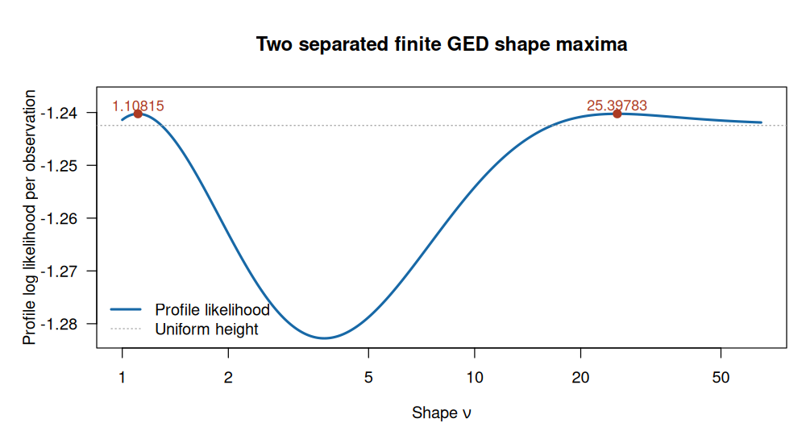
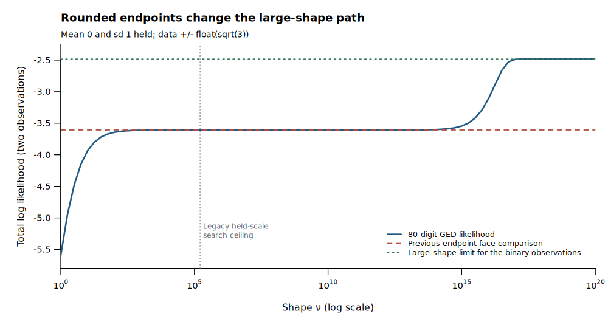

# GED free-shape certificate — TASK-116.33

Completed 2026-11-08 in `univariateML.wt/ged-free`, branch `codex/ged-free`,
base `d34a44cd1b0d7324e1f486d66e6b3f7e3db9210a`. No commits were made.

## Result

**O1 is closed.** All four free-shape subsets now pass through a global
profile-score certificate. Every public finite C++ `Ok` result sets
`GedResult::certified = true`. Failed enclosures stop with numerical,
comparison or budget details; they never promote a numerical proposal to a
finite success. The dossier now has `fit.certified: 'yes'` and describes this
scope in `fit.note`. Certification includes correct stops, rather than a
promise that every data set produces an estimate.

The free-shape fitting domain remains `nu >= 1`. Held positive shapes retain
their existing domain. The default `iterlim=200` and frozen golden file are
unchanged. Final required suites are green on the tested source hashes.

| Free coefficients | Fixed-shape profile | Global finite-shape acceptance |
|---|---|---|
| `{nu}` | Held mean and sd | Held-sd score and curvature enclosures; compare all retained roots and shape one. |
| `{mean,nu}` | Unique convex residual-power minimum above one; full median face at one | Same held-sd score with location enclosures and the location Schur complement. |
| `{sd,nu}` | Explicit scale profile, mean held | Free-sd envelope score and curvature enclosures. |
| `{mean,sd,nu}` | Convex location profile and explicit scale | Free-sd envelope score with the location correction. |

Both scale regimes include the entire large-shape tail. Free-sd uniform
selection requires exclusion of all finite competitors. An unresolved held-sd
uniform comparison stops numerically. Exact constant-data and sufficient
small-held-sd Laplace cases retain their analytic certificates.

Implementation is GED-local:
[finite-shape certificate](../../../univariateML-cpp/include/cppunivariate/distributions/ged/shape_certificate.hpp),
[interval/tail bounds](../../../univariateML-cpp/include/cppunivariate/distributions/ged/free_shape_bounds.hpp),
[public fitter](../../../univariateML-cpp/include/cppunivariate/distributions/ged/mle.hpp), and
[binding-neutral routing](../../../bindings/common/distributions/ged/fit.hpp).
R and JS fitting use that common routing. No SGED or shared core header was changed.
Legacy numerical helpers remain, but the public free-shape route cannot accept
their generic shape searches.

## Proof and acceptance rule

The [dossier](../../../univariateML-cpp/include/cppunivariate/distributions/ged/README.md#finite-shape-score-certificate)
gives the full derivations. The following identities explain how the narrow
bands left by likelihood bounds are closed.

For shape $p>1$, let $m(p)$ minimize the residual-power sum, or be the held
mean, and put $r_i=|x_i-m|$,
$T=\sum r_i^p$, $U=\sum r_i^p\log r_i$, $V=\sum r_i^p(\log r_i)^2$,
$H=\sum r_i^{p-2}$ and
$G=\sum\operatorname{sign}(m-x_i)r_i^{p-1}\log r_i$.
Strict convexity gives a unique profiled location above one. Its monotone
score supplies a bracket valid for every shape in a proposed interval.
Above a smooth portion of the location path,
$m'=-G/[(p-1)H]$; knot cases use the limiting inverse Hessian or disable
curvature contraction when a finite enclosure is unavailable.

For free sd the envelope identity is

$$
A(p)=p^2\ell'(p)/n=\psi(1+1/p)+\log p-D(p),\qquad
D=pU/T-\log(T/n).
$$

Writing $W=V/T-(U/T)^2$ gives

$$
D'=pW-\frac{p^2G^2}{(p-1)TH},\qquad
A'=\frac1p-\frac{\psi_1(1+1/p)}{p^2}-pW+
\frac{p^2G^2}{(p-1)TH}.
$$

Omit the $G$ term with mean held. These are envelope derivatives, so no
finite difference of a numerical location estimate is used.

For held sd write $b(p)=\sigma\sqrt{\Gamma(1/p)/\Gamma(3/p)}$,
$z_i=r_i/b(p)$, and
$\beta=[3\psi(1+3/p)-\psi(1+1/p)]/2$.
Using $T,U,V,H,G$ formed from $z_i$ instead gives

$$
A=\psi(1+1/p)-\beta+(p\beta T-p^2U)/n.
$$

Its derivative follows from $A'=2A/p+p^2\ell''/n$ and the raw likelihood
Hessian, adding the nonnegative location Schur complement when mean is free.
The dossier states the complete curvature formula. Thus holding scale does
not reuse the free-scale identity.

Digamma/trigamma monotonicity encloses the analytic terms. Location brackets
enclose residuals jointly over each shape interval. Elementary ranges of
$r^p$, $r^p\log r$ and $r^p(\log r)^2$, including their interior extrema,
then enclose the moments and scores. A definite score sign excludes
stationary points. A strictly negative upper curvature bound permits
monotone root contraction; other intervals are subdivided. Shape one is an
explicit candidate with its entire median face. This argument does not
assume a monotone location path or global unimodality in shape.

Every potentially winning root must be retained in boxes of width at most
$2\times10^{-7}(1+p_{\rm lower})$ in shape, $2\times10^{-7}$ in normalized
location, and $2\times10^{-7}$ in log-sd. Representatives are refined further.
Other root and boundary likelihood upper bounds must lie below the winner,
allowing the existing comparison tolerance $10^{-8}n$ and arithmetic margins.
Several roots inside one sufficiently small coefficient box need not be
distinguished. Separated unresolved competitors stop with witnesses.
The enclosure cover, rather than a good local root, supplies globality.

The earlier tail proofs remain part of this certificate. With free sd,
$\ell(p)/n=h(p)-\log R_p$ and

$$
\ell(p)/n\le-\log(2\rho)
-[\log p+1-\gamma-\log n]/p.
$$

This closes the whole tail once $p\ge n\exp(\gamma-1)$, including profiled
location and scale. Held-sd tails use the uniform peak remainder
$9n\zeta(2)/(4p^2)$ and retain endpoint penalties. Two extreme groups of
counts $k,l$ have optimized limiting penalty $2e^{-\gamma}\sqrt{kl}$,
controlling location shifts of order $1/p$. Finite-interval bounds include
$p=1$. A gamma-ratio density limit alone is not used to settle endpoints.

These are **exact-arithmetic certificates conditional on the computed
comparisons, with practical floating-point margins**. The base margin is
$4096\epsilon(1+\text{magnitude})(1+n\epsilon)$, enlarged by $1+p$ or $1+q$
for power arithmetic. Likelihood magnitudes include scale/normalizer
component mass to cover cancellation. There is no outward-rounded interval
arithmetic claim. The high-precision checks below are independent numerical
validation of these inequalities, not their proof.

## Stops, nonuniqueness and arithmetic checks

The outer certificate limit is `128 * min(iterlim, 100000)` evaluations;
inner solves use `min(iterlim, 100000)` iterations. Outer exhaustion is a
budget stop with feasible witnesses and a conservative upper bound, possibly
infinite. An inner solver cap remains non-convergence under the repository
[work-budget rules](../../design/work-budgets.md). Held subunit-shape knot
selection uses the enumeration budget and makes knot ties explicit.
The [control probes](2026-11-07-ged-free-data/o1-control-probes.tsv) retain
all four masks at limits 1, 2, 10 and 200, distinguishing numerical inner
stops from outer budget exhaustion. No cap was raised to obtain the successes.

**Exact nonuniqueness:** for observations $-1,1$, held sd $0.1$, free mean and
shape, the small-held-sd theorem makes every
$(\mu,\nu)\in[-1,1]\times\{1\}$ a global maximizer. The fitter stops with two
median endpoints. This disproves general free-shape uniqueness.

**Separated finite peaks, numerical evidence:** a symmetric sample has eight
zeros, 23 observations at each sign of radius `0.32998660809120006`, and 12
at each sign of radius `1.4239025460520294`. With sd one held, two competing
shape roots are approximately `1.108145553391854` and `25.39783214175462`.
An 80-digit construction tunes the inner radius to equalize their heights;
the rounded fixture differs by only $1.78\times10^{-17}$ per observation.
The fitter stops as a comparison tie with both roots, for held and free
mean. This numerical construction is not an exact equality proof for the
rounded sample. See [retained values](2026-11-07-ged-free-data/shape-tie.json)
and [construction](2026-11-07-ged-free-data/make_shape_tie.py).

Additional postconditions prevent a correct normalized cover from attaching
an incorrect original-coordinate answer:

- At `1e16 + 10 * golden`, inverse rounding formerly gave a certified finite
  result whose reported likelihood exceeded its actual coefficient
  likelihood by `0.0585050561`. The returned location now fails its round-trip
  check; a numerical stop retains a witness evaluated at its actual coefficients.
- With $u=2^{-53}$, data $-1+u,1+2u$ and held mean $u$, rounded residual
  equality would select a reflected uniform endpoint one, excluding the
  second observation. Original-coordinate support containment now rejects it.
- Normalizing $1,\ldots,19,10^{308}$ merges the central observations. The
  exact Laplace median interval is nevertheless $[10,11]$; both original
  endpoints are retained in the tie stop.
- At held shape $1/2$, data $(0,0,10^{-320})$ have ideal sd
  $10^{-320}\sqrt{120}/36$. An intermediate subnormal product previously
  returned a certified scale with log error `0.0046930274`. The analytic
  log-scale check now stops numerically. Underflow is not called scale collapse.

Held-shape primitive-quality checks also reject positive fractional-power
residuals lost to underflow. Exact constant-data collapse is handled before
numerical scale computation. See the precision/postcondition records in
[validation.json](2026-11-07-ged-free-data/validation.json).

The earlier rounded-endpoint counterexample also remains relevant:
`c(-sqrt(3),sqrt(3))` lies strictly inside the exact held-sd uniform support.
An 80-digit evaluation at shape $10^{19}$ improves on the old penalized
endpoint comparison by `1.1229189671` log-likelihood units. Those unresolved
faces stop numerically rather than advising `mlunif`.

Existing Laplace-success fixtures were changed from an even to an odd central
sample so they still test a unique attained Laplace fit. Appended tests cover
the former even sample's correct median-tie stop. Old held-sd endpoint limit
expectations were corrected to numerical stops. New C++ cases are appended;
the shared JS test file retains its entire original prefix.

## Final validation

[Machine-readable evidence](2026-11-07-ged-free-data/validation.json) records
all tested source hashes, counts, timings, independent roots, precision
probes, protected-file checks and the unchanged base commit.

| Final command/check | Machine | Result |
|---|---|---|
| `just cpp-test` | simbox, GCC 13.3 | 106/106, 82.11 s |
| `UMVL_TEST_TIER=full just cpp-test` | simbox, GCC 13.3 | 129/129, 203.50 s |
| `just cpp-test-no-long-double` | simbox, GCC 13.3 | 129/129, 221.70 s |
| `just cpp-test-no-long-double` | workstation, GCC 15.2 | 129/129, 231.68 s |
| `just test` | simbox, R binding compiler g++-15 | FAIL 0, WARN 0, SKIP 154, PASS 21427; 77.5 s |
| `just test-full` | simbox, R binding compiler g++-15 | FAIL 0, WARN 0, SKIP 0, PASS 44233; 320.9 s |
| Targeted GED R full file | simbox | 370 passes, zero failures/warnings |
| `just js-build` / `just js-test` | workstation | build green; 490/490 tests |
| `just site-check` | workstation | green; 99 family pages, MathML, links, C++17 snippets and browser checks |
| Independent raw-likelihood derivative oracle | simbox, mpmath 70 digits | 232 interval rows, 2746 checks, zero violations |
| Independent golden roots, all four subsets | simbox, mpmath 70 digits | maximum absolute coefficient error $2.20\times10^{-10}$ |

Frozen golden bytes were not changed. The default fitted shape differs from
its frozen reference by about $1.19\times10^{-6}$, within existing golden
tolerances; no tolerance was loosened. The independent roots validate the
new coefficients more accurately than the frozen reference.

One new R regression initially asserted a numerical fitter stop with all
coefficients held. R's fully held constructor evaluates density directly and
bypasses the fitter. The corrected regression leaves mean free and passes;
the final dev and full runs above both completed green. The direct-density
limitation is explicitly retained as D1 below.

Reproduction scripts are
[simbox suites](2026-11-07-ged-free-data/o1-final-simbox.sh),
[final R reruns](2026-11-07-ged-free-data/o1-final-r.sh),
[workstation suites](2026-11-07-ged-free-data/o1-final-local.sh),
[independent checks and benchmarks](2026-11-07-ged-free-data/o1-final-evidence.sh), and
[evidence collector](2026-11-07-ged-free-data/collect_evidence.py).
Run compute scripts through the instructed slot wrappers. The collector
checks the final R test hash from its rerun and unchanged implementation
hashes from the completed native/JS/site runs.

## Before/after timings

Median wall times in milliseconds, simbox GCC 13.3, `-std=c++17 -O2`,
`gradtol=1.220703e-4`, `iterlim=200`. Five repetitions use the frozen 500-point
sample; three use 10,000 distinct deterministic GED(0,1,3) quantiles
$q((j+1/2)/10000)$. Large-sample holds are mean zero and/or sd one; golden
holds use the frozen coefficients. All final fits are finite and certified.

“Before” is the captured pre-O1 implementation reviewed in the initial
report, including its already completed uniform/Laplace work; it is retained
as [o1-baseline-mle.hpp](2026-11-07-ged-free-data/o1-baseline-mle.hpp).
The old estimates were uncertified. Compilation is excluded. Shared-machine
load affects elapsed time, so these are measured costs, not controlled
causal speedup estimates.

| Sample | Free coefficients | Before ms | After ms | Certificate evaluations |
|---|---|---:|---:|---:|
| Golden, n=500 | mean, sd, nu | 15.618 | 383.442 | 342 |
| Golden, n=500 | sd, nu | 12.105 | 42.352 | 250 |
| Golden, n=500 | mean, nu | 557.754 | 309.308 | 319 |
| Golden, n=500 | nu | 25.601 | 33.308 | 209 |
| Quantiles, n=10000 | mean, sd, nu | 348.162 | 4137.062 | 410 |
| Quantiles, n=10000 | sd, nu | 233.055 | 1041.386 | 277 |
| Quantiles, n=10000 | mean, nu | 12875.240 | 3681.074 | 322 |
| Quantiles, n=10000 | nu | 606.632 | 660.926 | 195 |

[Timing table](2026-11-07-ged-free-data/timings.tsv) and validation JSON retain
coefficients, likelihoods, repetition counts and individual measurements.
No default increase is needed: the largest measured certificate uses 410 of
25,600 allowed evaluations. Location profiling makes joint certification
more expensive than the former local proposal; held-sd location profiling
avoids the former grid cost on these samples.

## Open D1 — protected density primitive, outside O1

The settled `ged/dpqr.hpp` log-density fallback handles overflow of
`(x-mean)/sd`, but not a positive residual rounded to zero. For
`x=1e-100`, `mean=0`, `sd=1e300`, held `nu=.02`, an 80-digit direct evaluation
gives log density `-612.224579676587918...`; the current protected primitive
gives `-612.22457872605537`. Its omitted kernel is approximately
`9.50532505e-7`. This exceeds the stated practical margin.

Needed change: extend the GED log-domain residual fallback to positive
standardized-residual underflow and add independent truth/regression
coverage, including R's fully held density-evaluation path. Those protected
sources were explicitly excluded by the task and remain unchanged. The
new C++/common fitter guards reject the affected held-subunit arithmetic;
all four free-shape subsets have `nu >= 1` and are unaffected by this
fractional-power failure. This is a direct-density follow-up, not a remaining
finite-shape certificate gap.

The [80-digit evidence](2026-11-07-ged-free-data/density-underflow.json),
[C++ probe](2026-11-07-ged-free-data/check_density_underflow.cpp) and
[independent evaluator](2026-11-07-ged-free-data/check_density_underflow.py)
make D1 reproducible. Protected GED d/p/q/r and truth files, SGED, special
headers, code generators, shared core, NEWS, status and roadmap files were
not changed. No dependencies were installed or board entries edited.

## Artifact delivery

The report and both figures remain in this worktree. The requested `show`
command returned HTTP 403 because the worktree is outside the artifact
viewer's registered readable roots. No viewer configuration was changed and
no files were copied to the main checkout or another worktree.
