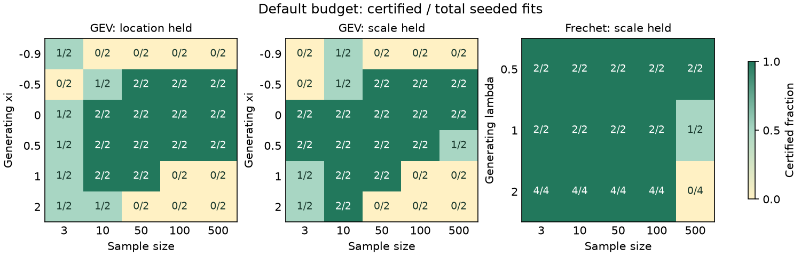

# GEV and Fréchet held-nuisance certificates — TASK-170

Implemented and validated in `codex/gev-held`, based on `69c214f3`.
Changes are uncommitted. All numerical runs below used the workstation.

## Delivered behavior

The three requested hold scopes now have global certificate paths:

- GEV free shape and scale, public location held;
- GEV free shape and location, public scale held;
- Fréchet free shape and location, public scale held.

[GEV's constrained cover](../../../univariateML-cpp/include/cppunivariate/distributions/gev/held_certificate.hpp)
reuses the joint module's interval arithmetic and compensated sums. It evaluates
constrained two-coordinate jets, isolates a maximum using Krawczyk inclusion or
endpoint score signs, contracts its coefficient enclosure with interval Newton,
and covers the remaining parameter region with likelihood and score bounds.
The [Fréchet extension](../../../univariateML-cpp/include/cppunivariate/distributions/frechet/certificate.hpp)
uses the same cover with its distinct held-scale likelihood and shape tail.
This full constrained stationary/value box cover avoids assuming profile
unimodality or treating the numerical proposer as a global certificate.

An incomplete cover, unclosed comparison, coefficient inclusion failure or
certificate allowance exhaustion returns the **unchanged successful search,
marked uncertified**. Existing search failures and compatible-member precision
stops retain their behavior. A strict feasible counterexample is separate:
a fresh public-coordinate likelihood comparison precedes `SearchContradicted`,
a numerical stop carrying both feasible point witnesses. The losing-local-
maximum regression exercises this rejection mechanism.

For these hold scopes, R exposes a logical `certified` fit attribute; the
common/JavaScript result exposes zero or one. The C++ field is populated for
these routes and compatible exact held members; older routes have not been
retrofitted with a general per-fit flag. Both dossiers retain
**`fit.certified: partial`**, because ordinary cases remain uncertified below.
Default fitting paths, public restrictions, default controls and frozen golden
files were retained. No existing tests were deleted or rewritten.

## Mathematical evidence and precision

The [derivation](2026-11-10-gev-held-data/proof.md) proves the exact-arithmetic
bounds and states the floating-point conditions:

- GEV's density satisfies `f(x) <= min(1/sigma, sigma/(x-mu)^2)` uniformly on
  `-1 <= xi <= 1`. Above a feasible likelihood level this gives compact nuisance
  regions. With location held, the small-scale bound requires more than half
  the observations to differ from the hold; earlier collapse classifiers remain.
- With GEV scale held, the proved positive-shape location-root region supplies
  a uniform slab enclosure. The Gumbel seam retains the public hold. Value
  envelopes include moving support and the closed reverse-exponential face;
  support-crossing boxes do not supply unchecked derivative jets.
- Held-scale Fréchet's unique fixed-shape gap root lies in `[b(lambda),1)`.
  A monotone slab lower bound encloses the inner roots; a decreasing,
  range-dependent likelihood envelope excludes the infinite-shape tail.
  A free-scale Gumbel fit is never substituted under this hold.
- Inclusion checks every free coefficient, with GEV location widths measured
  after the original public affine map. Public support and likelihood are
  checked again before accepting a certificate.

These are **exact-arithmetic certificates conditional on computed comparisons
with practical floating-point margins**, not outward-rounded interval proofs.
Jet endpoints use compensated accumulation and a 128-epsilon pad; moving-support
value envelopes use 512 epsilons. Strict counterexample comparisons use 4096
epsilons and a further public-coordinate recheck. Certificate precision and
restoration use `min(tol,0.01)`. Requests below 1024 epsilons or insufficient
public coefficient resolution retain an uncertified search. Finite differences
and seeded fits check the implementation numerically; they do not prove rounding
bounds.

## Seeded study

[Source](2026-11-10-gev-held-data/study.cpp),
[raw fits](2026-11-10-gev-held-data/study.csv),
[aggregate results](2026-11-10-gev-held-data/summary.json), and
[selected diagnostic reconstructions](2026-11-10-gev-held-data/diagnostics.csv)
are retained. `sample_id` distinguishes every dataset, including the two
independent Fréchet shape-two streams.

Seed: `17020261110`; C++17/GCC 15.2, `-O2`, one thread under `nice -n 10`.
GEV used generating shapes `-0.9,-0.5,0,0.5,1,2`, sizes `3,10,50,100,500`,
two samples per cell, and both public holds (`mu=0` or `sigma=1`). Fréchet used
`mu=0,sigma=1` generating data with shapes `0.5,1,2`: two samples per size for
shapes 0.5 and 1, and four for shape 2. This is 100 datasets and 160 fits.
Generating parameters beyond the free fit restriction test its attained bound.
Each fit used `tol=1e-10,maxit=100`, allowing 12,800 certificate evaluations.
Fractions describe this fixed grid, not a population certification probability.

Timings include the existing search and certificate, excluding compilation,
slot waits and diagnostic reconstruction. The shared workstation was contended;
these single-pass timings are not throughput benchmarks. Times below are ms.

| Scope | Fits | Certified | Uncertified | Stops | Median | 95th percentile | Maximum |
|---|---:|---:|---:|---:|---:|---:|---:|
| GEV, location held | 60 | 33 (55.0%) | 27 (45.0%) | 0 | 261.9 | 4544.8 | 7351.6 |
| GEV, scale held | 60 | 35 (58.3%) | 25 (41.7%) | 0 | 161.1 | 4456.6 | 9649.5 |
| Fréchet, scale held | 40 | 35 (87.5%) | 5 (12.5%) | 0 | 13.0 | 818.0 | 1109.6 |

Overall: **103 certified, 57 uncertified, zero stops**. Every uncertified fit
remained successful; no certificate budget or unresolved stop was introduced.



## Validation

[Validation records and source hashes](2026-11-10-gev-held-data/validation.json)
and [golden checker output](2026-11-10-gev-held-data/golden-checks.txt) accompany
the study. The six certificate/binding headers in the generated R package were
also compared byte-for-byte with the final sources.

| Check | Machine | Final result |
|---|---|---|
| Targeted GEV/Fréchet C++ shards | workstation | 2/2 passed |
| `just cpp-test` dev | workstation | 106/106 passed |
| `UMVL_TEST_TIER=full just cpp-test` | workstation | 129/129 passed |
| `just cpp-test-no-long-double` | workstation, GCC 15.2 | 129/129 passed |
| `just test` | workstation, R 4.6.1 | FAIL 0, WARN 0, SKIP 154, PASS 22,742 |
| `just test-full` | workstation, R 4.6.1 | FAIL 0, WARN 0, SKIP 0, PASS 45,557 |
| `just js-build` / `just js-test` | workstation, Node 22.22.1 | build passed; 588/588 tests passed |
| `just site-check` | workstation | passed, including browser and build-time MathML checks |
| `just quality gev frechet` | workstation | both passed |

Golden regressions test the actual fitters against frozen references; the quality
harness checks those references against symbolic densities and a numerical
multistart oracle. Neither replaces the held-case proof. New regressions cover
constrained jets, moving support, strict rejection of a losing maximum,
unchanged low-budget fallback, the Fréchet shape-one boundary, and both bindings'
certificate markers.

## Open entries

**G2: local inclusion and the active support face.** General isolation on the
active `xi=-1` moving-support face needs a one-sided constrained argument. Its
value envelope is implemented; smooth rectangle jets cannot isolate an
observation at zero residual. Near-face or constrained local inclusion also
fails on ordinary data. Selected failures include sample 0 (scale held, n=3,
generating xi=-0.9), sample 8 (scale held, n=500, xi=-0.9), and small-sample
cases 10, 20, 60 and 80. Their reconstructions never reached coefficient
contraction. A face isolator and tighter or conditioned root enclosures are
missing; increasing work alone is not established to fix these cases.

**G2: default-allowance outer coverage.** Samples 8 (location held), 76 (both
holds separately) and 96 (both holds separately) reached coefficient inclusion
but exhausted 12,800 evaluations during the remaining global cover. Stronger
constrained profile/score/value enclosures are needed. The present implementation
does not certify every supported held-nuisance fit. Its general held-location
compactness argument also leaves `2*j <= n` outside the proof; earlier analytic
collapse and compatible-member cases remain in place.

**F1: large-sample outer coverage.** All five uncertified Fréchet cases have
n=500. Diagnosed samples 37 and 57 (generating lambda=2), and 77 (lambda=1),
have tight stationary coefficient enclosures but exhaust the global cover.
The finite root rectangle and infinite-shape tail are proved and implemented;
stronger constrained profile/value bounds are needed to complete these ordinary
default-budget covers. A proper Gumbel-face substitution cannot resolve them.

**Cross-machine validation.** The simbox wrapper returned 75, and subsequent
SSH probes, including the final probe, timed out on port 22 (255). The full
proxy suite ran locally as instructed. GCC 13 on simbox was not validated;
GCC 15 native/proxy and actual WASM were validated.

**Unrelated Markdown checker findings.** The repository-wide checker reports
41 hits in unchanged files, including old audit text, a missing generated PDF,
and site-route links. These are checked against `HEAD` in the retained link
record. The task's changed/new Markdown destinations are checked separately.
They were not repaired by changing unrelated research reports or another family.

proof note. All report, data and figure files remain in this authorized worktree;
no copy was made into the main checkout.

## Reproduction

Create `build/tmp` and `build/scratch`; set `TMPDIR`, `JUST_TEMPDIR` and
`XDG_RUNTIME_DIR` to `$PWD/build/tmp` as in the brief. Run tests through the
supplied slot wrappers. From the worktree root, reproduce the study with:

```sh
gev_held_boost=$(Rscript -e 'cat(system.file("include",package="BH"))')
/tmp/umvl-cpu/run g++ -std=c++17 -O2 -IunivariateML-cpp/include -I"$gev_held_boost" dev/research/evaluations/2026-11-10-gev-held-data/study.cpp -o build/scratch/held-study
/tmp/umvl-cpu/run build/scratch/held-study > dev/research/evaluations/2026-11-10-gev-held-data/study.csv
/tmp/umvl-cpu/run python3 dev/research/evaluations/2026-11-10-gev-held-data/summarize.py
/tmp/umvl-cpu/run python3 dev/research/evaluations/2026-11-10-gev-held-data/plot.py
```

The plot uses the already installed matplotlib. No packages were installed.
No commits, board edits, pushes, publications or protected project-status edits
were made.
