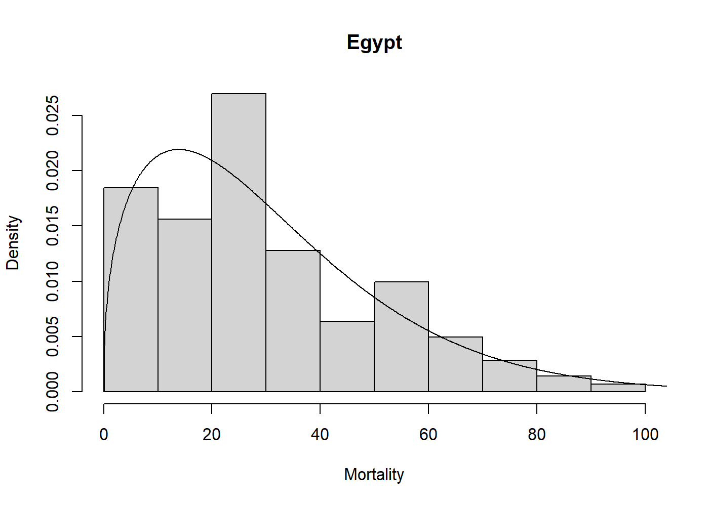

<!-- README.md is generated from README.Rmd. Please edit that file -->

# univariateML 

[](https://github.com/JonasMoss/univariateML/actions)
[](https://app.codecov.io/gh/JonasMoss/univariateML?branch=master)
[](https://www.repostatus.org/#active)
[](https://doi.org/10.21105/joss.01863)
[](https://cran.r-project.org/package=univariateML)

## Overview

[`univariateML`](https://jonasmoss.github.io/univariateML/index.html) is
an `R`-package for user-friendly maximum likelihood estimation of a
[selection](https://jonasmoss.github.io/univariateML/articles/distributions.html)
of parametric univariate densities and probability mass functions. In
addition to basic estimation capabilities, this package support
visualization through `plot` and `qqmlplot`, model selection by `AIC`
and `BIC`, confidence sets through the parametric bootstrap with
`bootstrapml`, and convenience functions such as the density,
distribution function, quantile function, and random sampling at the
estimated distribution parameters.

## Installation

Use the following command from inside `R` to install from CRAN.

``` r
install.packages("univariateML")
```

Or install the development version from Github.

``` r
# install.packages("devtools")
devtools::install_github("JonasMoss/univariateML")
```

## Usage

The core of `univariateML` are the `ml***` functions, where `***` is a
distribution suffix such as `norm`, `gamma`, or `weibull`.

``` r
library("univariateML")
mlweibull(egypt$age)
#> Loading required package: intervals
#> Maximum likelihood estimates for the Weibull model 
#>  shape   scale  
#>  1.404  33.564
```

Now we can visually assess the fit of the Weibull model to the `egypt`
data with a plot.

``` r
hist(egypt$age, freq = FALSE, xlab = "Mortality", main = "Egypt")
lines(mlweibull(egypt$age))
```



## Supported distributions

<!-- distributions: start (generated by scripts/readme_table.R) -->

### Continuous distributions (63)

| Distribution | Function | d/p/q/r from |
|---|---|---|
| Azzalini skew-normal | `mlsn` | univariateML |
| Beta | `mlbeta` | stats |
| BetaPrime | `mlbetapr` | extraDistr |
| Bhattacharjee | `mlbhatt` | extraDistr |
| Birnbaum-Saunders | `mlfatigue` | extraDistr |
| Burr | `mlburr` | actuar |
| Cauchy | `mlcauchy` | stats |
| Exponential | `mlexp` | stats |
| Exponentially Modified Gaussian | `mlemg` | univariateML |
| Feller-Pareto | `mlfpareto` | actuar |
| Folded Normal | `mlfoldnorm` | univariateML |
| Frechet | `mlfrechet` | extraDistr |
| Gamma | `mlgamma` | stats |
| Generalized beta of the first kind | `mlgenbeta` | actuar |
| Generalized Error | `mlged` | univariateML |
| Generalized extreme value | `mlgev` | extraDistr |
| Generalized Pareto | `mlgpd` | extraDistr |
| Gompertz | `mlgompertz` | extraDistr |
| Gumbel | `mlgumbel` | extraDistr |
| Half-Cauchy | `mlhcauchy` | extraDistr |
| Half-t | `mlht` | extraDistr |
| Huber | `mlhuber` | extraDistr |
| Inverse Burr | `mlinvburr` | actuar |
| Inverse exponential | `mlinvexp` | actuar |
| Inverse Gaussian | `mlinvgauss` | actuar |
| Inverse paralogistic | `mlinvparalogis` | actuar |
| Inverse Pareto | `mlinvpareto` | actuar |
| Inverse transformed gamma | `mlinvtrgamma` | actuar |
| InverseWeibull | `mlinvweibull` | actuar |
| InvGamma | `mlinvgamma` | extraDistr |
| Kumaraswamy | `mlkumar` | extraDistr |
| Laplace | `mllaplace` | extraDistr |
| Location-scale Student-t | `mllst` | extraDistr |
| Loggamma | `mllgamma` | actuar |
| Logistic | `mllogis` | stats |
| LogitNormal | `mllogitnorm` | univariateML |
| Loglogistic | `mlllogis` | actuar |
| Lognormal | `mllnorm` | stats |
| Lomax | `mllomax` | extraDistr |
| Nakagami | `mlnaka` | univariateML |
| Nonstandard beta | `mlnsbeta` | extraDistr |
| Normal | `mlnorm` | stats |
| Paralogistic | `mlparalogis` | actuar |
| Pareto | `mlpareto` | extraDistr |
| Pareto type II | `mlpareto2` | actuar |
| Pareto type III | `mlpareto3` | actuar |
| Pareto type IV | `mlpareto4` | actuar |
| PowerDist | `mlpower` | extraDistr |
| Rayleigh | `mlrayleigh` | extraDistr |
| Shifted Gompertz | `mlsgomp` | univariateML |
| Skew Generalized Error | `mlsged` | univariateML |
| Skew Normal | `mlsnorm` | univariateML |
| Skew Student-t | `mlsstd` | univariateML |
| Slash | `mlslash` | extraDistr |
| Student-t | `mlstd` | univariateML |
| Transformed beta (GB2) | `mlgb2` | actuar |
| Transformed gamma | `mltrgamma` | actuar |
| Translated Half-Normal | `mlhnorm` | extraDistr |
| Triangular | `mltriang` | extraDistr |
| Truncated Normal | `mltnorm` | extraDistr |
| Tukey lambda | `mltlambda` | univariateML |
| Uniform | `mlunif` | stats |
| Weibull | `mlweibull` | stats |

### Discrete distributions (35)

| Distribution | Function | d/p/q/r from |
|---|---|---|
| Beta negative binomial | `mlbnbinom` | extraDistr |
| Beta-binomial | `mlbbinom` | extraDistr |
| Binomial | `mlbinom` | stats |
| Conway--Maxwell--binomial | `mlcmb` | univariateML |
| Conway--Maxwell--Poisson | `mlcmp` | univariateML |
| Discrete Laplace | `mldlaplace` | extraDistr |
| Discrete uniform | `mldunif` | extraDistr |
| Discrete Weibull | `mldweibull` | extraDistr |
| Discretized gamma | `mldgamma` | extraDistr |
| Discretized normal | `mldnorm` | extraDistr |
| Geometric | `mlgeom` | stats |
| Hypergeometric | `mlhyper` | stats |
| Logarithmic series | `mllgser` | extraDistr |
| Negative binomial | `mlnbinom` | stats |
| Negative hypergeometric | `mlnhyper` | extraDistr |
| Poisson | `mlpois` | stats |
| Poisson-inverse Gaussian | `mlpig` | actuar |
| Skellam | `mlskellam` | univariateML |
| Truncated binomial | `mltbinom` | extraDistr |
| Truncated Poisson | `mltpois` | extraDistr |
| Yule--Simon | `mlyulesimon` | univariateML |
| Zero-inflated binomial | `mlzib` | extraDistr |
| Zero-inflated negative binomial | `mlzinb` | extraDistr |
| Zero-inflated Poisson | `mlzip` | extraDistr |
| Zero-modified binomial | `mlzmbinom` | actuar |
| Zero-modified geometric | `mlzmgeom` | actuar |
| Zero-modified logarithmic | `mlzmlogarithmic` | actuar |
| Zero-modified negative binomial | `mlzmnbinom` | actuar |
| Zero-modified Poisson | `mlzmpois` | actuar |
| Zero-truncated binomial | `mlztbinom` | actuar |
| Zero-truncated geometric | `mlztgeom` | actuar |
| Zero-truncated negative binomial | `mlztnbinom` | actuar |
| Zero-truncated Poisson | `mlztpois` | actuar |
| Zeta | `mlzeta` | univariateML |
| Zipf | `mlzipf` | univariateML |

<!-- distributions: end -->

## Implementations

Analytic formulae for the maximum likelihood estimates are used whenever
they exist. Most `ml***` functions without analytic solutions have a
custom made Newton-Raphson solver. These can be much faster than a naïve
solution using `nlm` or `optim`. For example, `mlbeta` has a large
speedup over the naïve solution using `nlm`.

``` r
# install.packages("microbenchmark")
set.seed(313)
x <- rbeta(500, 2, 7)

microbenchmark::microbenchmark(
  univariateML = univariateML::mlbeta(x),
  naive = nlm(function(p) -sum(dbeta(x, p[1], p[2], log = TRUE)), p = c(1, 1))
)
#> Unit: microseconds
#>          expr    min      lq     mean median     uq     max neval
#>  univariateML  201.4  244.05  349.978  365.6  422.2   791.9   100
#>         naive 8289.4 8652.60 9170.378 8915.3 9288.0 18723.0   100
```

The maximum likelihood estimators in this package have all been subject
to testing, see the `tests` folder for details.

## Documentation

For an overview of the package and its features see the [overview
vignette](https://jonasmoss.github.io/univariateML/articles/overview.html).

## How to Contribute or Get Help

Please read `CONTRIBUTING.md` for details about how to contribute or get
help.
